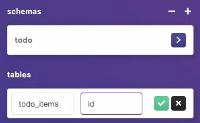
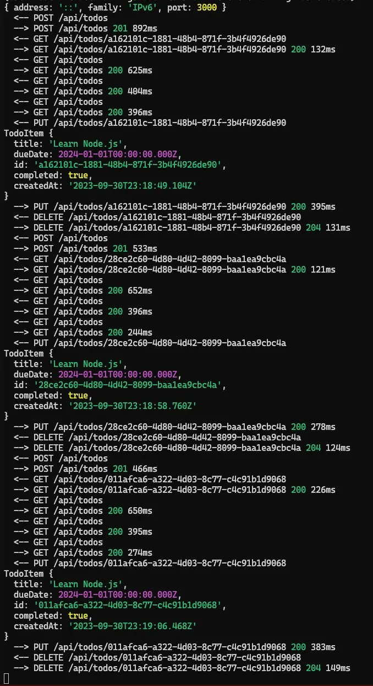
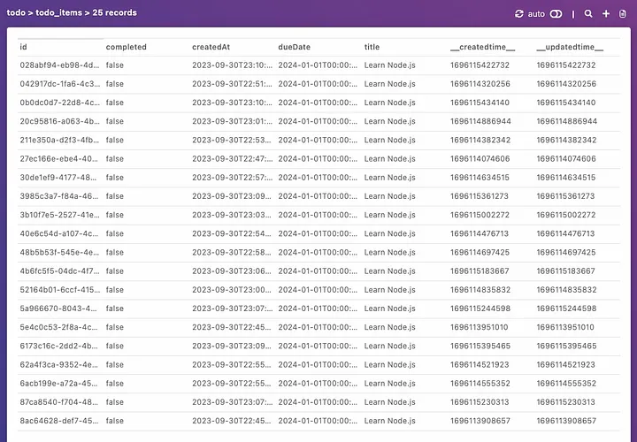

Quando você está trabalhando com o HarperDB, pode usar TypeScript para melhorar sua experiência de desenvolvimento. Este artigo vai te mostrar algumas boas práticas para usar TypeScript com o HarperDB. Vamos falar sobre estruturas de pastas, boas práticas de código e como configurar melhor seu projeto para tirar o máximo proveito do HarperDB.

## Antes de começar

Dá uma passada na [documentação do HarperDB](https://docs.harperdb.io/docs/install-harperdb) para saber como instalar localmente e dar os primeiros passos. Você também pode usar o [HarperDB Cloud](https://harperdb.io/) para começar rapidinho. Mas vou assumir que você já tem sua instância rodando.

> [!TIP]
> Você pode conferir alguns dos meus outros tutoriais [aqui](https://www.harperdb.io/author/lucas-santos) ou [neste artigo específico da comunidade](https://www.harperdb.io/development/tutorials/harperdb-authentication-with-oauth) para saber como montar sua infraestrutura localmente, com Kubernetes, ou na nuvem.

Este repositório está no [GitHub da comunidade HarperDB](https://github.com/HarperDB-Add-Ons/hdb-typescript-best-practices). Você pode cloná-lo e acompanhar o artigo. Vamos usar a versão cloud do banco de dados mas, no repositório, você vai encontrar um arquivo `docker-compose.yml` que pode usar para rodar localmente com `docker compose up`.

### Configurando Node e TypeScript

Para usar TypeScript você precisa do Node.js instalado, use a versão LTS mais recente. Você pode conferir rodando `node -v` no seu terminal. Se não tiver instalado, pode baixar [aqui](https://nodejs.org/en/download/), ou usar um gerenciador de versões como [asdf](https://asdf-vm.com/#/core-manage-asdf-vm), [nvm](https://github.com/nvm-sh/nvm), ou até mesmo o [volta](https://volta.sh/).[^n1]

Vamos criar um novo diretório (você pode dar o nome que quiser) e, dentro dele, vamos rodar o comando `npm init -y`. Isso vai gerar um novo arquivo `package.json` com os valores padrão. Agora, vamos instalar o TypeScript como dependência de desenvolvimento rodando `npm install --save-dev typescript`. Isso vai instalar a versão mais recente do TypeScript no seu projeto.

> [!TIP]
> Você pode conferir a versão mais recente do TypeScript [aqui](https://www.npmjs.com/package/typescript). Estou usando a versão 5.2.2

Também vamos instalar os tipos externos do Node.js rodando `npm install --save-dev @types/node`. Isso vai nos permitir usar os tipos do Node.js no nosso projeto.

Por último, vamos adicionar um pacote de apoio chamado [tsx](https://npm.im/tsx), que vai nos permitir desenvolver a aplicação sem ter que compilar toda vez que mudarmos algo. Vamos instalá-lo rodando `npm install --save-dev tsx`.

Vamos então inicializar o typescript com `npx tsc --init`, isso vai gerar um arquivo `tsconfig.json` com todas as definições que o TS precisa. Mas vamos precisar mudar alguns valores lá. Então vamos abri-lo, remover todos os valores e deixá-lo assim:

```json
{
  "compilerOptions": {
    "target": "ESNext",
    "module": "NodeNext",
    "outDir": "./dist",
    "esModuleInterop": true,
    "forceConsistentCasingInFileNames": true,
    "strict": true,
    "skipLibCheck": true
  }
}
```

Também vamos usar ESModules, então precisamos mudar a chave `type` no nosso arquivo `package.json` para `module`. Isso vai nos permitir usar a sintaxe `import` no nosso código, vamos também adicionar um script de execução que vai nos permitir rodar o código compilado. Nosso arquivo `package.json` vai ficar assim:

```json
{
  "name": "hdb-typescript-best-practices",
  "version": "0.0.1",
  "description": "",
  "main": "index.js",
  "type": "module",
  "scripts": {
    "start": "node --env-file=.env dist/index.js",
    "start:dev": "NODE_OPTIONS='--loader=tsx' node --env-file=.env src/index.ts"
  },
  "keywords": [],
  "author": "Lucas Santos <hello@lsantos.dev> (https://lsantos.dev/)",
  "license": "GPL-3.0",
  "devDependencies": {
    "@types/node": "^20.7.1",
    "tsx": "^3.13.0",
    "typescript": "^5.2.2"
  }
}
```

### Testando a configuração

Agora, vamos criar uma pasta `src` e um arquivo `index.ts` dentro dela. Esse vai ser o entrypoint da nossa aplicação. Vamos também adicionar as pastas `dist` e `node_modules` ao nosso arquivo `.gitignore` (se ainda não tiver adicionado), para não commitarmos o código compilado.

O Node.js a partir da versão 20.6 [passou a ter suporte nativo a arquivos env](https://nodejs.org/en/blog/release/v20.6.0), então vamos aproveitar isso para guardar nossos segredos em um arquivo `.env`, essa é a primeira boa prática:

> [!CAUTION]
> Nunca commite segredos no seu repositório. Use um arquivo `.env` para guardá-los e adicione-o ao seu `.gitignore`.

Vamos criar um arquivo `.env` e adicionar o seguinte conteúdo:

```ini
EXAMPLE=Test environment
```

Agora, vamos adicionar o seguinte código ao nosso arquivo `index.ts`:

```ts
export async function main() {
  console.log('Hello world!')
  console.log(process.env.EXAMPLE)
}

await main()
```

Agora rode a configuração com `npm run start:dev`, você deve ver a seguinte saída:

```bash
$ npm run start:dev
Hello World!
Test environment
```

Isso significa que está tudo configurado corretamente!

> [!TIP]
> Você também pode rodar o arquivo manualmente através da compilação, para isso, você precisa rodar `npx tsc` no diretório raiz, e depois rodar `node --env-file=.env dist/index.js`. O resultado vai ser o mesmo. Você pode até adicionar um script `build` que tenha `tsc` como comando, assim você pode rodar `npm run build` e depois `npm run start` para executar o código.

## Configurando os ambientes e o banco de dados

Agora que sabemos que está tudo funcionando, vamos para o [HarperDB Studio](https://studio.harperdb.io) e criar nosso schema. Vamos criar um novo schema chamado `todo` e uma tabela chamada `todo_items`. Essa vai ser a tabela que vai armazenar os itens da lista de tarefas.

O `hash` da tabela vai ser a coluna `id`:



O Harper tem um schema maleável, então não precisamos definir todas as propriedades, só a propriedade hash inicial, todas as outras serão adicionadas conforme criarmos os objetos.

Vamos definir nossas variáveis de ambiente no arquivo `.env`:

```ini
HDB_HOST=https://your-instance.harperdbcloud.com
HDB_USERNAME=your username
HDB_PASSWORD=your password
HDB_SCHEMA=todo
HDB_TABLE=todo_items
```

# Separando camadas

Para nossa aplicação, vamos criar a simples e gloriosa aplicação de lista de tarefas. Essa aplicação vai ter as seguintes funcionalidades:

- Criar um novo item
- Listar todos os itens
- Marcar um item como concluído
- Deletar um item

É uma aplicação simples, mas vai nos permitir explorar algumas das boas práticas de usar TypeScript com o HarperDB.

Também vamos usar uma arquitetura em camadas para separar nosso código. Isso vai nos permitir ter uma separação de responsabilidades melhor e deixar nosso código mais fácil de manter. Arquiteturas em camadas permitem que o TypeScript brilhe porque podemos usar interfaces para definir nossos contratos e garantir que nosso código está seguindo a estrutura correta.

Vamos ter pelo menos três camadas:

- **Camada de apresentação**: É a camada que faz interface com o usuário. Pode ser uma CLI, uma aplicação web, ou até mesmo uma aplicação mobile. Essa camada vai ser responsável por receber o input do usuário e enviá-lo para a próxima camada. No nosso caso, vamos ter a API, que vai ser uma API REST que vai receber o input do usuário e enviá-lo para a próxima camada. Mas isso nos permite separar a lógica real da aplicação da camada de apresentação, o que nos dá a possibilidade de trocar a camada de apresentação por outra tecnologia sem ter que mudar a lógica da aplicação. Então poderíamos adicionar uma CLI, um endpoint GraphQL, gRPC, ou qualquer outra coisa sem ter que mudar a estrutura por baixo.
- **Camada de domínio ou de serviço**: É a camada que vai ter a lógica de negócio da nossa aplicação. Vai ser responsável por receber o input validado do usuário e agir sobre ele. Também vai ser responsável por receber os dados da camada de dados e transformá-los no formato correto para a camada de apresentação. Essa camada vai ser a que tem mais lógica, e pode ser separada em várias partes. A camada de domínio pode ser acessada por qualquer outra camada já que é uma parte central do sistema.
- **Camada de dados**: Como o nome diz, é a camada que vai ser responsável pelos dados, os dados podem vir de qualquer fonte, um banco de dados, um client externo, etc. Vai ser responsável por receber os dados da camada de domínio e transformá-los no formato correto para o banco de dados. Também vai ser responsável por receber os dados do banco e transformá-los no formato correto para a camada de domínio. Essa camada vai ser a que tem menos lógica, mas é a mais importante, porque é onde vamos colocar a lógica do nosso banco de dados, e a comunicação com ele.

Isso é bem próximo da famosa [arquitetura MVC](https://en.wikipedia.org/wiki/Model%E2%80%93view%E2%80%93controller), mas pega um pouco das definições de [Domain Driven Design](https://en.wikipedia.org/wiki/Domain-driven_design) e [Clean Architecture](https://blog.cleancoder.com/uncle-bob/2012/08/13/the-clean-architecture.html).

## A camada de domínio

Antes de criar qualquer camada, precisamos modelar nosso objeto de domínio, que é o item da lista. Isso vai nos permitir entender melhor o que precisamos fazer e como precisamos fazer. Vai nos permitir entender qual é o formato do nosso objeto e como vamos manipulá-lo.

Vamos começar com uma pasta domain dentro de `src`, lá vamos criar um arquivo chamado `TodoItem.ts`. Esse vai ser nosso objeto de domínio, então vamos adicionar o seguinte código nele:

```ts
import { randomUUID } from 'node:crypto'

export class TodoItem {
  constructor(
    public title: string,
    public dueDate: Date,
    readonly id: string = randomUUID(),
    public completed: boolean = false,
    readonly createdAt: Date = new Date()
  ) {}
}
```

Essa é uma classe simples que vai representar nosso item. Ela tem um construtor que recebe o título e a data de vencimento, e define as outras propriedades. O `id` é um UUID aleatório, o `completed` é false por padrão, e o `createdAt` é a data atual.

Então agora podemos criar um novo item rodando `new TodoItem('My first to-do item', new Date())`. Isso vai criar um novo item com o título `My first to-do item` e a data de vencimento como a data atual.

> [!TIP]
> Você pode conferir a [documentação do Node.js](https://nodejs.org/api/crypto.html#crypto_crypto_randomuuid_options) para saber mais sobre a função `randomUUID`.

Vamos adicionar algumas funcionalidades ao nosso objeto de domínio para torná-lo mais útil. Vamos adicionar um método `toJSON` que vai retornar o objeto como uma string JSON, e um método estático `fromObject` que vai receber um objeto que corresponde ao nosso Data Object e retornar uma nova instância da classe.

Para isso vamos precisar criar um schema com o qual possamos comparar e validar nosso objeto, esse é o caso de uso perfeito para o [Zod](https://zod.dev)! Zod é uma biblioteca de validação de schemas TypeScript-first que nos permite criar schemas e validar nossos objetos contra eles. Vamos instalá-la rodando `npm install --save zod`.

Para definir o schema temos duas opções:

1. Definimos em um novo arquivo e importamos no nosso objeto de domínio
2. Definimos dentro do objeto de domínio

Eu pessoalmente prefiro a segunda opção já que tanto o schema quanto o objeto de domínio são fortemente acoplados e parte do mesmo objeto, então faz sentido tê-los no mesmo arquivo. Mas você pode escolher a que fizer mais sentido para você.

Vamos adicionar o seguinte código no topo do nosso objeto de domínio:

```ts
import { z } from 'zod'

const todoItemSchema = z.object({
  title: z.string(),
  dueDate: z.date(),
  id: z.string().uuid(),
  completed: z.boolean().default(false),
  createdAt: z.date().default(new Date())
})

export type TodoObjectType = z.infer<typeof TodoObjectSchema>
```

> [!NOTE]
> Também é possível imitar de certa forma o que estamos fazendo no `z.infer<typeof TodoObjectSchema>` usando o utility type `InstanceType`, mas aí precisaríamos remover os métodos do tipo, então prefiro usar o método `infer` para também criar uma sensação clara de separação entre o que é nosso objeto de domínio (a classe) e o data transfer object (o JSON)

Vamos então usar esse schema para garantir que nosso objeto é um item válido. Vamos mudar a função `fromJSON` no nosso objeto de domínio:

```ts
static fromObject(todoObject: TodoObjectType): InstanceType<typeof TodoItem> {
  TodoObjectSchema.parse(todoObject) // This will throw an error if the object is not valid
  return new TodoItem(todoObject.title, todoObject.dueDate, todoObject.id, todoObject.completed, todoObject.createdAt)
}
```

Isso vai fazer o parse da string JSON e retornar uma nova instância da classe. Podemos também adicionar um `toObject` para transformar a classe em um objeto serializável, e um método `toJSON` que vai retornar a string JSON, isso vai ser útil quando precisarmos enviar o objeto para o banco de dados. Vamos adicionar o seguinte código ao nosso objeto de domínio:

```ts
toObject() {
  return JSON.stringify({
    title: this.title,
    dueDate: this.dueDate,
    id: this.id,
    completed: this.completed,
    createdAt: this.createdAt
  })
}

toJSON() {
  return JSON.stringify(this.toObject())
}
```

> [!TIP]
> Outra coisa que podemos fazer aqui é não usar o método `toObject` e em vez disso usar o atalho `{ ...item }`, que vai convertê-lo automaticamente em um objeto. Mas eu prefiro ter um método que posso chamar para deixar isso mais explícito. Você também pode retornar `{ ...this }`

Nosso objeto de domínio final vai ficar assim:

```ts
import { randomUUID } from 'node:crypto'
import { z } from 'zod'

const TodoObjectSchema = z
  .object({
    title: z.string(),
    dueDate: z.date({ coerce: true }),
    id: z.string().uuid().readonly(),
    completed: z.boolean().default(false),
    createdAt: z.date({ coerce: true }).default(new Date()).readonly()
  })
  .strip()
export type TodoObjectType = z.infer<typeof TodoObjectSchema>

export class TodoItem {
  constructor(
    public title: string,
    public dueDate: Date,
    readonly id: string = randomUUID(),
    public completed: boolean = false,
    readonly createdAt: Date = new Date()
  ) {}

  toObject() {
    return JSON.stringify({
      title: this.title,
      dueDate: this.dueDate,
      id: this.id,
      completed: this.completed,
      createdAt: this.createdAt
    })
  }

  toJSON() {
    return JSON.stringify(this.toObject())
  }

  static fromObject(todoObject: TodoObjectType): InstanceType<typeof TodoItem> {
    TodoObjectSchema.parse(todoObject)
    return new TodoItem(todoObject.title, todoObject.dueDate, todoObject.id, todoObject.completed, todoObject.createdAt)
  }
}
```

## A camada de dados

Agora que temos nosso objeto de domínio, podemos começar a criar nossa camada de dados. Essa camada vai ser responsável por se comunicar com o banco de dados e transformar os dados vindos dele no formato correto para a camada de domínio. Também vai ser responsável por transformar os dados da camada de domínio no formato correto para o banco.

Como estamos usando o Harper, toda a nossa comunicação com o banco é feita através de uma API! O que é extremamente útil porque não precisamos configurar drivers complicados nem nada do tipo. Então vamos criar um novo arquivo em uma pasta `data` chamado `TodoItemClient.ts`. Esse vai ser nosso client do HarperDB.

> [!TIP]
> É uma boa prática nomear APIs externas como 'clients', se tivéssemos qualquer outra camada de dados, digamos um sistema de filas que não é conectado através de uma API, poderíamos simplesmente chamá-la de `queueAdapter` ou `queue` e estaria tudo bem. Isso não é uma regra, mas eu pessoalmente acho mais fácil entender o que o arquivo está fazendo, se é um agente externo ou um driver interno.

Nosso client é uma API HTTP, então vamos usar o `fetch` nativo do node para nos comunicarmos com ela.[^n2] Vamos adicionar o seguinte código ao nosso arquivo `TodoItemClient.ts`:

```ts
import { TodoItem, TodoObjectType } from '../domain/TodoItem.js'

export class TodoItemClient {
  #defaultHeaders: Record<string, string> = {
    'Content-Type': 'application/json'
  }
  credentialsBuffer: Buffer

  constructor(
    private readonly url: string,
    private readonly schema: string,
    private readonly table: string,
    credentials: { username: string; password: string }
  ) {
    this.credentialsBuffer = Buffer.from(`${credentials.username}:${credentials.password}`)
    this.#defaultHeaders['Authorization'] = `Basic ${this.credentialsBuffer.toString('base64url')}`
  }

  async upsert(data: TodoItem) {
    const payload = {
      operation: 'upsert',
      schema: this.schema,
      table: this.table,
      records: [data.toObject()]
    }

    const response = await fetch(this.url, {
      method: 'POST',
      headers: this.#defaultHeaders,
      body: JSON.stringify(payload)
    })

    if (!response.ok) {
      throw new Error(response.statusText)
    }

    return data
  }

  async delete(id: string) {
    const payload = {
      operation: 'delete',
      schema: this.schema,
      table: this.table,
      hash_values: [id]
    }

    const response = await fetch(this.url, {
      method: 'POST',
      headers: this.#defaultHeaders,
      body: JSON.stringify(payload)
    })

    if (!response.ok) {
      throw new Error(response.statusText)
    }
  }

  async findOne(id: string) {
    const payload = {
      operation: 'search_by_hash',
      schema: this.schema,
      table: this.table,
      hash_values: [id],
      get_attributes: ['*']
    }

    const response = await fetch(this.url, {
      method: 'POST',
      headers: this.#defaultHeaders,
      body: JSON.stringify(payload)
    })

    if (!response.ok) {
      throw new Error(response.statusText)
    }

    const data = (await response.json()) as TodoObjectType[]
    if (data[0] && Object.keys(data[0]).length > 0) {
      return TodoItem.fromObject(data[0])
    }

    return null
  }

  async listByStatus(completed = true) {
    const payload = {
      operation: 'search_by_value',
      schema: this.schema,
      table: this.table,
      search_attribute: 'completed',
      search_value: completed,
      get_attributes: ['*']
    }

    const response = await fetch(this.url, {
      method: 'POST',
      headers: this.#defaultHeaders,
      body: JSON.stringify(payload)
    })

    if (!response.ok) {
      throw new Error(response.statusText)
    }

    const data = (await response.json()) as TodoObjectType[]
    return data.map((todoObject) => TodoItem.fromObject(todoObject))
  }
}
```

Como você pode ver, isso tem todos os métodos de que precisamos para nos comunicar com o banco de dados. Temos o método `upsert` que vai criar ou atualizar um registro, o método `delete` que vai deletar um registro, o método `findOne` que vai buscar um registro pelo seu hash, e o método `listByStatus` que vai listar todos os registros que correspondem a um determinado valor.

> [!TIP]
> Você pode conferir a [documentação do HarperDB](https://api.harperdb.io/#25977fef-53e8-40bf-a26a-43369bc3721c) para saber mais sobre as operações.

## A camada de serviço

A camada de serviço vai ser a cola entre todas as outras camadas. Em uma aplicação tão simples assim, ela normalmente não é muito útil, mas é uma boa prática tê-la, para podermos adicionar mais lógica depois. Vamos criar uma nova pasta chamada `services` e um novo arquivo chamado `TodoItemService.ts`. Essa vai ser nossa camada de serviço.

A camada de serviço vai receber o input sanitizado do usuário, executar qualquer lógica de negócio e então enviá-lo para a camada de dados. Também vai receber dados da camada de dados e transformá-los no formato correto para a camada de apresentação.

Vamos adicionar o seguinte código ao nosso arquivo `TodoItemService.ts`:

```ts
import { TodoItemClient } from '../data/TodoItemClient.js'
import { TodoItem, TodoObjectType } from '../domain/TodoItem.js'

export class TodoItemService {
  #client: TodoItemClient
  constructor(client: TodoItemClient) {
    this.#client = client
  }

  async findOne(id: string) {
    return this.#client.findOne(id)
  }

  async findAll() {
    return [...(await this.findPending()), ...(await this.findCompleted())]
  }

  async findCompleted() {
    return this.#client.listByStatus(true)
  }

  async findPending() {
    return this.#client.listByStatus(false)
  }

  async create(todoItem: TodoObjectType) {
    const todo = new TodoItem(todoItem.title, todoItem.dueDate)
    return this.#client.upsert(todo)
  }

  async update(todoItem: TodoObjectUpdateType) {
    const todo = await this.#client.findOne(todoItem.id ?? '')

    if (!todo) {
      throw new Error('Todo not found')
    }

    todo.completed = todoItem.completed ?? todo.completed
    todo.dueDate = todoItem.dueDate ?? todo.dueDate
    todo.title = todoItem.title ?? todo.title

    return this.#client.upsert(todo)
  }

  async delete(id: string) {
    return this.#client.delete(id)
  }
}
```

Veja que, enquanto na implementação do client em uma camada mais baixa, temos uma lógica mais genérica que busca por status. No serviço, já separamos os comandos em buscar itens pendentes e concluídos.

Além disso, implementamos um método `findAll` que chama o método `listByStatus` duas vezes e depois junta os resultados. Esse é um bom exemplo de como podemos usar a camada de serviço para adicionar mais lógica à nossa aplicação sem de fato adicionar mais lógica à camada de dados.

Outro aspecto importante de notar é como a camada de serviço já assume que todos os dados vão estar sanitizados. Essa é uma boa prática porque nos permite ter uma separação de responsabilidades melhor. A camada de apresentação deve ser a que valida os dados na rota, e então os envia para a camada de serviço. A camada de serviço deve assumir que os dados já estão validados e sanitizados.

> [!NOTE]
> De qualquer forma, já implementamos outro nível de validações no nosso objeto de domínio quando estamos recebendo objetos, porque o TypeScript só vai garanti-las em tempo de compilação, então podemos ter certeza de que os dados são válidos.

A última coisa a notar é que, agora que subimos um nível, a camada de serviço está recebendo como parâmetro a camada abaixo, o que significa que precisamos passar uma instância do client da camada de dados para a camada de serviço. Isso se chama **inversão de controle** e é parte do [princípio da inversão de dependência](https://en.wikipedia.org/wiki/Dependency_inversion_principle).

Esse princípio diz que as camadas de nível mais alto não devem depender das camadas de nível mais baixo, mas sim depender de abstrações. No nosso caso, a camada de serviço depende da camada de dados, mas não depende da implementação da camada de dados, depende da abstração da camada de dados, que é o client.

Vamos fazer a mesma coisa com a camada de apresentação.

## A camada de apresentação

Agora que temos nossa camada de dados, podemos começar a criar nossa camada de apresentação. Essa camada vai ser responsável por receber o input do usuário e enviá-lo para a próxima camada. No nosso caso, vamos ter a API, que vai ser uma API REST que vai receber o input do usuário e enviá-lo para a próxima camada.

Vamos criar uma nova pasta chamada `presentation` e um novo arquivo chamado `restAPI.ts`. Essa vai ser nossa interface REST.

Normalmente usamos um framework web para evitar ter que recriar tudo. Neste exemplo vamos usar um framework muito rápido chamado [Hono](https://hono.dev), só para ficar longe do [Express](https://expressjs.com) por um tempo.

Instale ele e depois o adapter dele para Node.js rodando `npm install --save hono @hono/node-server`.

A implementação da camada de serviço normalmente cai no [Factory Pattern](https://en.wikipedia.org/wiki/Factory_method_pattern), que é um padrão de criação que nos permite criar objetos sem ter que conhecer os detalhes de implementação. No nosso caso, vamos usar uma factory para criar o client da API REST para podermos receber (via injeção de dependência) a camada de serviço.

Isso se traduz em algo assim:

```ts
import { Hono } from 'hono'
import { TodoItemService } from '../services/TodoItemService.js'

export async function restAPIFactory(service: TodoItemService) {
  const app = new Hono()

  app.get('/api/todos/:id', async (c) => {})
  app.get('/api/todos', async (c) => {})
  app.post('/api/todos', async (c) => {})
  app.put('/api/todos/:id', async (c) => {})
  app.delete('/api/todos/:id', async (c) => {})

  return app
}
```

Essa é uma factory bem simples que recebe a camada de serviço e retorna uma nova instância do client da API REST. Vamos implementar as rotas daqui a pouco, mas primeiro, vamos voltar ao nosso arquivo `index.ts` no diretório `src`. Esse vai ser o entrypoint da nossa aplicação.

Lá vamos inicializar as variáveis de ambiente, assim como o client do banco de dados e a camada de serviço. Vamos adicionar o seguinte código ao nosso arquivo `index.ts`:

```ts
import { z } from 'zod'
import { TodoItemClient } from './data/TodoItemClient.js'
import { TodoItemService } from './services/TodoItemService.js'
import { restAPIFactory } from './presentation/api.js'
import { serve } from '@hono/node-server'
const conf = {
  host: process.env.HDB_HOST,
  credentials: {
    username: process.env.HDB_USERNAME,
    password: process.env.HDB_PASSWORD
  },
  schema: process.env.HDB_SCHEMA,
  table: process.env.HDB_TABLE
}

const EnvironmentSchema = z.object({
  host: z.string(),
  credentials: z.object({
    username: z.string(),
    password: z.string()
  }),
  schema: z.string(),
  table: z.string()
})
export type EnvironmentType = z.infer<typeof EnvironmentSchema>

export default async function main() {
  const parsedSchema = EnvironmentSchema.parse(conf)
  const DataLayer = new TodoItemClient(
    parsedSchema.host,
    parsedSchema.schema,
    parsedSchema.table,
    parsedSchema.credentials
  )
  const ServiceLayer = new TodoItemService(DataLayer)
  const app = await restAPIFactory(ServiceLayer)

  serve({ port: 3000, fetch: app.fetch }, console.log)
}

await main()
```

> [!NOTE]
> Poderíamos ter criado outro arquivo chamado `config.ts` e movido tanto nosso `EnvironmentSchema` quanto o objeto `conf` para lá, mas como só estamos usando no arquivo `index.ts`, prefiro mantê-los ali. Porém, se você receber essa configuração em outro lugar, deveria criar um arquivo `config.ts` e movê-la para lá.

De volta ao nosso arquivo `restAPI.ts`, vamos implementar as rotas. A maioria delas vai ter só parâmetros de rota, então vou colocá-las aqui e explicar a lógica:

```ts
import { Hono } from 'hono'
import { TodoItemService } from '../services/TodoItemService.js'

export async function restAPIFactory(service: TodoItemService) {
  const app = new Hono()

  app.get('/api/todos/:id', async (c) => {
    try {
      const todo = await service.findOne(c.req.param('id'))
      if (!todo) {
        c.status(404)
        return c.json({ error: 'Todo not found' })
      }
      c.json(todo.toObject())
    } catch (err) {
      c.status(500)
      c.json({ error: err })
    }
  })

  app.get('/api/todos', async (c) => {
    try {
      let data

      if (c.req.query('completed')) {
        data = await service.findCompleted()
      } else if (c.req.query('pending')) {
        data = await service.findPending()
      } else {
        data = await service.findAll()
      }

      c.json(data.map((todo) => todo.toObject()))
    } catch (err) {
      c.status(500)
      c.json({ error: err })
    }
  })

  app.post('/api/todos', async (c) => {})
  app.put('/api/todos/:id', async (c) => {})

  app.delete('/api/todos/:id', async (c) => {
    try {
      await service.delete(c.req.param('id'))
      c.status(204)
      return c.body(null)
    } catch (err) {
      c.status(500)
      c.json({ error: err })
    }
  })

  return app
}
```

Para as rotas post e put, também vamos precisar validar os dados que chegam, o Hono tem um validador para Zod que podemos usar como middleware, vamos instalá-lo com `npm i @hono/zod-validator`.

Podemos importar o `zValidator` dele e adicioná-lo depois do nome da rota, mas antes do nosso handler, assim:

```ts
app.post('/api/todos', zValidator('json', ourSchema) async (c) => {})
```

Mas vamos precisar de algumas coisas aqui, primeiro, vamos precisar de um novo tipo para representar o tipo de criação, e outro para representar o tipo de atualização. Vamos adicionar o seguinte código ao nosso arquivo `TodoItem.ts`:

```ts
export const TodoObjectCreationSchema = TodoObjectSchema.omit({ id: true, createdAt: true, completed: true }).extend({
  dueDate: z.string().datetime()
})
export const TodoObjectUpdateSchema = TodoObjectSchema.omit({ createdAt: true }).partial().extend({
  dueDate: z.string().datetime().optional()
})

export type TodoObjectType = z.infer<typeof TodoObjectSchema>
export type TodoObjectCreationType = z.infer<typeof TodoObjectCreationSchema>
export type TodoObjectUpdateType = z.infer<typeof TodoObjectUpdateSchema>
```

Estamos criando novos tipos mais restritos a partir de um tipo mais amplo gerado pelo Zod. Precisamos atualizar esse tipo no arquivo do serviço:

```ts
async create(todoItem: TodoObjectCreationType) {
  const todo = new TodoItem(todoItem.title, new Date(todoItem.dueDate))
  return this.#client.upsert(todo)
}

async update(todoItem: TodoObjectUpdateType) {
  const todo = await this.#client.findOne(todoItem.id ?? '')

  if (!todo) {
    throw new Error('Todo not found')
  }

  todo.completed = todoItem.completed ?? todo.completed
  todo.dueDate = new Date(todoItem.dueDate ?? todo.dueDate)
  todo.title = todoItem.title ?? todo.title

  return this.#client.upsert(todo)
}
```

Agora podemos usar esses tipos na camada de apresentação. Vamos adicionar o seguinte código ao nosso arquivo `restAPI.ts`:

```ts
app.post('/api/todos', zValidator('json', TodoObjectCreationSchema), async (c) => {
  try {
    const todoItemObject = await c.req.json<TodoObjectCreationType>()
    const todo = await service.create(todoItemObject)
    c.status(201)
    c.json(todo.toObject())
  } catch (err) {
    c.status(500)
    c.json({ error: err })
  }
})
```

Agora a rota de atualização:

```ts
app.put('/todos/:id', zValidator('json', TodoObjectUpdateSchema), async (c) => {
  try {
    const todoItemObject = await c.req.json<TodoObjectUpdateType>()
    const todo = await service.update({ ...todoItemObject, id: c.req.param('id') })
    c.status(200)
    return c.json(todo.toObject())
  } catch (err) {
    c.status(500)
    return c.json({ error: err })
  }
})
```

E é isso! Temos nossa camada de apresentação pronta!

# Testando

Testar nossa aplicação é questão de rodar `npm run start:dev` e fazer requisições para ela. Para testar melhor vou deixar um arquivo [Hurl](https://hurl.dev) no repositório que você pode usar para testar a API. Você pode rodá-lo usando `hurl --test ./collection.hurl`. Isso vai rodar todos os testes e garantir que tudo está funcionando como esperado.



Você também pode fazer requisições para a API você mesmo usando `curl` ou qualquer outra ferramenta que preferir. Depois confira o seu HarperDB studio para ver se os dados foram inseridos corretamente.



# Conclusão

Neste artigo, aprendemos como configurar um projeto TypeScript com o HarperDB, aprendemos a separar nosso código em camadas, e aprendemos a testar nossa aplicação. Também aprendemos algumas boas práticas pelo caminho.

A ideia é que essas camadas não são imutáveis, você pode adicionar mais camadas se precisar, ou remover algumas se não precisar delas. O importante é ter uma separação de responsabilidades clara e garantir que seu código seja fácil de manter.

[^n1]: Estou usando a versão 20.7.0 do Node.js, mas você pode usar qualquer versão acima da 18 no momento em que escrevo este artigo.

[^n2]: A api fetch só está disponível no node a partir da versão 18.
