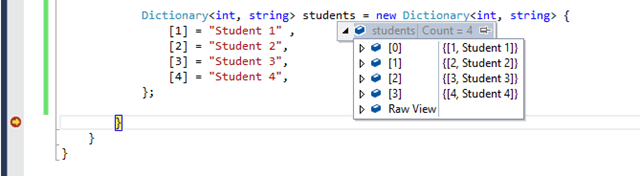

Desde o início da humanidade tentamos relacionar coisas em objetos de chave e valor, por exemplo, uma lista de convidados de uma festa, listas de presença de uma turma, contagem de praticamente qualquer coisa e assim por diante.


La Pascaline, a primeira calculadora mecânica do mundo

Quando as primeiras [máquinas programáveis](https://pt.wikipedia.org/wiki/Pascalina) apareceram, lá atrás, com as calculadoras mecânicas, um novo problema foi criado: como podemos transpor listas de chaves e valores para uma estrutura computacional que seja ao mesmo tempo fácil de manipular e segura?

E então surgiram os *Hash Maps*.

## E então os maps foram feitos.

Se você está acostumado a trabalhar com Java, provavelmente já ouviu falar ou até mesmo usou um hash map. Eles são as implementações mais comuns de objetos iteráveis contendo chaves e valores ou, como também são chamados, *dicionários* (o pessoal do C# surta).



Em linguagens fortemente tipadas (como Java e C#), temos que especificar os tipos tanto da chave quanto do valor que vamos armazenar (veja `<int, string>`), mas como fazemos isso em Javascript? Uma linguagem tão dinâmica que nem os programadores dão conta?

Bom, a resposta para isso é bem simples: nós não fazemos. Como o Javascript já tem objetos de chave e valor naturalmente (assim como Python e PHP), não precisamos de nenhum tratamento especial, então isso cria uma estrutura facilmente iterável, mas e quanto à segurança?

Um uso muito comum para os maps do Javascript é quando mapeamos chaves do tipo *string* para um valor arbitrário, como abaixo:

```js
let kennel = {}

function add (name, meta) {
  kennel[name] = meta
}

function get (name) {
  return kennel[name]
}

add('Heckle', { color: 'Black', breed: 'Dobermann' })
add('Jeckle', { color: 'White', breed: 'Pitbull'})
```

Vamos criar uma lista de cachorros, obviamente, mas temos alguns problemas com esse design de projeto:

- **Segurança**: Imagine que uma das chaves se chame `__proto__` ou `toString`  ou qualquer coisa dentro de `Object.prototype`  então vamos ter um grande problema, como eu já disse no meu [artigo sobre protótipos (em português)](https://medium.com/trainingcenter/heran%C3%A7a-e-prot%C3%B3tipos-no-javascript-2c1e60e005a2), nunca é uma boa ideia mexer com eles diretamente. Além disso, estamos criando um comportamento praticamente imprevisível no nosso código.
- As iterações sobre esses itens vão ser bem verbosas com `Object.keys(kennel).forEach`, a não ser que você implemente um [iterator](https://medium.com/trainingcenter/iterators-em-javascript-880adef14495), o que também é um pouco verboso.
- As chaves são limitadas a *strings* simples, então é complicado criar outras chaves de outros tipos que não sejam *strings* ou que sejam apenas referências.

### A primeira solução

Para resolver o primeiro problema de segurança, simplesmente adicionamos um prefixo no início da chave, o que a torna diferente de qualquer coisa nativa:

```js
let kennel = {}
function add (name, meta) {
  kennel[`map:${name}`] = meta
}
function get (name) {
  return kennel[`map:${name}`]
}

add('Heckle', { color: 'Black', breed: 'Dobermann' })
add('Jeckle', { color: 'White', breed: 'Pitbull'})
```

Mas, por sorte, o ES6 chegou para resolver os problemas que tínhamos no ES5.

## Maps no ES6

Com o advento do ES6 temos uma estrutura específica para lidar com maps. Ela se chama, surpreendentemente, `Map`. Vamos ver como ficaria se convertêssemos nosso código anterior para essa nova estrutura:

```js
let map = new Map()
map.set('Heckle', { color: 'Black', breed: 'Dobermann' })
map.set('Jeckle', { color: 'White', breed: 'Pitbull' })
```

Bem mais simples, né?

A principal diferença aqui é que podemos usar **qualquer coisa** como chave. Não estamos mais limitados a tipos primitivos, podemos usar também funções, objetos, datas, qualquer coisa.

```js
let map = new Map()
map.set(new Date(), function foo () {})
map.set(() => 'key', { foo: 'bar' })
map.set(Symbol('items'), [1,2])
```

Obviamente, muitas dessas coisas não fazem sentido prático, mas são modelos possíveis de usar.

A outra mudança significativa é que `Map` é [iterável](https://medium.com/trainingcenter/iterators-em-javascript-880adef14495) e produz uma coleção de valores mais ou menos do tipo `[ ['key', 'value'], ['key', 'value'] ]`  .

```js
let map = new Map([
  [new Date(), function foo () {}],
  [() => 'key', { foo: 'bar' }],
  [Symbol('items'), [1,2]]
])
```

Essa é outra forma de inicializar um Map

O que está acima é o mesmo que usar `map.set` para cada valor que inserimos. É meio burro adicionar os itens um a um quando podemos simplesmente incluir um **iterável inteiro** no nosso `map` direto. O que nos dá o *spread operator* como efeito colateral:

```js
let map = new Map()
map.set('f', 'o')
map.set('o', 'b')
map.set('a', 'r')
	
console.log([...map]) // [ ['f', 'o'], ['o', 'b'], ['a', 'r'] ]
```

E já que temos o poder do iterator nas mãos, podemos misturar tudo: destructuring, `for ... of` , template literals e por aí vai:

```js
let map = new Map()
map.set('f', 'o')
map.set('o', 'b')
map.set('a', 'r')

for (let [key, value] of map) {
  console.log(`${key}: ${value}`)
  // 'f: o'
  // 'o: b'
  // 'a: r'
}
```

E agora que sabemos um pouco sobre hash maps, podemos falar de uma coisa que talvez não tenha ficado clara no começo. Apesar de ter uma implementação de uma API de adição, todas as chaves são únicas, o que significa que, se continuarmos escrevendo em uma chave, ela só vai sobrescrever o próprio valor:

```
let map = new Map()
map.set('a', 'a')
map.set('a', 'b')
map.set('a', 'c')
console.log([...map]) // [ ['a', 'c'] ]
```

### O caso do NaN

Esse caso é importante destacar. Acho que todos sabemos que `NaN` é um monstro muito estranho do Javascript que se comporta de maneiras bem... exóticas...

"Naturalmente", uma expressão como `NaN !== NaN` vai dar `true` como produto, ou seja, `NaN` não é igual a `NaN`, e isso normalmente causa essa reação nos programadores:


Mas! No nosso Map, se definirmos uma chave como sendo `NaN` , o valor dela vai ser `NaN` , ou seja, ela vai se resolver sozinha:

```js
console.log(NaN === NaN) // false
let map = new Map()
map.set(NaN, 'foo')
map.set(NaN, 'bar')
console.log([...map]) // [[NaN, 'bar']]
```

E essa é a apresentação de um *corner case* bizarro que acontece quando usamos Maps.

## Maps e DOM

No ES5 tínhamos um grande problema quando precisávamos associar um elemento do DOM a uma API. A abordagem padrão era criar um código extenso como o abaixo, que simplesmente retorna um objeto de API com vários métodos que manipulam elementos do DOM, permitindo que a gente os inclua ou remova do Cache e obtenha um objeto de API para o elemento, caso ele exista:

```js
let cache = []
function put(el, api) {
  cache.push({ el: el, api: api })
}

function find(el) {
  for (i = 0; i < cache.length; i++) {
    if (cache[i].el === el) {
      return cache[i].api
    }
  }
}

function destroy(el) {
  for (i = 0; i < cache.length; i++) {
    if (cache[i].el === el) {
      cache.splice(i, 1)
      return
    }
  }
}

function thing(el) {
  let api = find(el)
  if (api) {
    return api
  }

  api = {
    method: method,
    method2: method2,
    method3: method3,
    destroy: destroy.bind(null, el)
  }
  put(el, api)
  return api
}
```

No ES6, temos a grande vantagem de poder indexar elementos do DOM como chave, então podemos simplesmente adicionar o método relativo a ele em um valor como função.

```js
let cache = new Map()

function put(el, api) {
  cache.set(el, api)
}

function find(el) {
  return cache.get(el)
}

function destroy(el) {
  cache.delete(el)
}

function thing(el) {
  let api = find(el)
  if (api) {
    return api
  }

  api = {
    method: method,
    method2: method2,
    method3: method3,
    destroy: destroy.bind(null, el)
  }

  put(el, api)
  return api
}

```

O ganho aqui não é só de leitura, mas também de performance. Note que todos os métodos (ou a maioria deles) agora têm só uma linha de código, o que significa que podemos deixá-los *inline* sem problema nenhum, economizando espaço de requisição em uma aplicação front-end.

## Outras coisas com Maps

### Symbols

`Maps` são coleções de dados, as famosas *collections* que assombram todo estudante de algoritmos na faculdade. Isso significa que é fácil buscar dentro delas se uma chave existe ou não. Temos o caso exótico do `NaN`  que mencionei acima, mas fora isso todos os objetos `Symbol` são tratados de forma diferente, então você vai precisar usá-los por valor:

```js
let map = new Map([[NaN, 1], [Symbol(), 2], ['foo', 'bar']])

console.log(map.has(NaN)) // true
console.log(map.has(Symbol())) // false
console.log(map.has('foo')) // true
console.log(map.has('bar')) // false
```

Viu o que aconteceu? `Symbol`  é sempre um objeto único que retorna uma referência, então, enquanto você mantiver a referência que o `Symbol`  te deu, está tudo certo.

```js
let sym = Symbol()
let map = new Map([[NaN, 1], [sym, 2], ['foo', 'bar']])

console.log(map.has(sym)) // true
```

### Key-Cast

Diferente do nosso modelo inicial, onde só tínhamos chaves do tipo *string*, os *maps* permitem qualquer tipo de informação e não fazem nenhuma conversão desses tipos, podemos estar acostumados a transformar tudo em *string*, mas lembre-se de que isso não é mais necessário.

```js
let map = new Map([[1, 'a']])

console.log(map.has(1)) //true
console.log(map.has('1')) //false
```

### Clear

Podemos limpar um `Map` sem perder a referência para ele, porque ele é uma coleção, como já foi mencionado.

```js
let map = new Map([[1, 2], [3, 4], [5, 6]])
map.clear()
console.log(map.has(1)) // false
console.log([...map]) // []
```

### Entries e Iterators

Se você leu [meu artigo sobre iterators](https://medium.com/trainingcenter/iterators-em-javascript-880adef14495), vai ter reconhecido o `Map` como um modelo de implementação desse protocolo. 

Então isso significa que você pode iterar pelos seus `.entries()`, mas, se estivermos usando `Map` como um *iterable*, isso já vai ser feito de qualquer forma, então você não precisa iterar explicitamente, veja que `map[Symbol.iterator] === map.entries` vai retornar `true`.

Assim como `.entries()`, `Map` tem outros dois métodos que você pode aproveitar, `.keys()` e `.values()`. Então, basicamente eles são autoexplicativos...

```js
let map = new Map([[1, 2], [3, 4], [5, 6]])

console.log([...map.keys()]) // [1, 3, 5]
console.log([...map.values()]) // [2, 4, 6]
```

### Size

`Map` também vem por padrão com uma propriedade somente leitura chamada `.size`  que te dá, a qualquer momento, o número de pares no hash map. Ela se comporta basicamente igual ao `Array.prototype.length`.

```js
let map = new Map([[1, 2], [3, 4], [5, 6]])

console.log(map.size) // 3

map.delete(3)
console.log(map.size) // 2

map.clear()
console.log(map.size) // 0
```

### Ordenação

Uma penúltima coisa que vale mencionar é que os pares de um `Map` são iterados na **ordem de inserção** e não em ordem aleatória como acontecia com `Object.keys`. 

Tanto é que usávamos `for ... in` para iterar sobre as propriedades de um objeto de forma completamente arbitrária.

### Loop

Por fim, temos o conhecido método `forEach()`, que basicamente faz o que o método análogo de `Array` faz.[^n1]

```js
let map = new Map([[NaN, 1], [Symbol(), 2], ['foo', 'bar']])
map.forEach((value, key) => console.log(key, value))
//NaN 1
//Symbol() 2
//'foo' 'bar'
```

# Conclusão
Os Maps realmente vieram para salvar quando o assunto são coleções de chaves e valores ou dicionários de dados que temos que manipular de forma muito complicada no ES5, mas precisamos tomar cuidado e também, acima de tudo, conhecer a estrutura com a qual estamos trabalhando para não acabar tendo um objeto de chave que não entendemos.

Não deixe de acompanhar mais do meu conteúdo no meu [blog](https://blog.lsantos.dev)!

Espero que você tenha gostado, visite [este artigo](https://ponyfoo.com/articles/es6-maps-in-depth) para saber mais, tirei bastante conteúdo dele e muitos exemplos também :)

[^n1]: Lembre-se de que aqui não temos chaves como strings.
