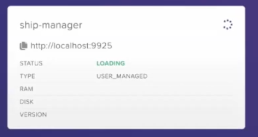
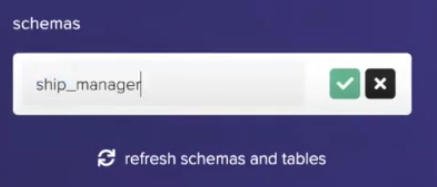
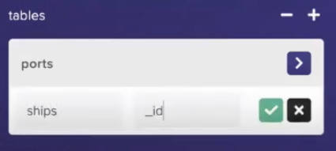
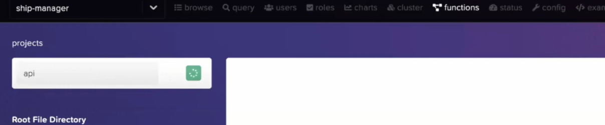
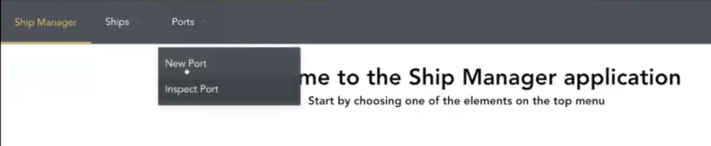
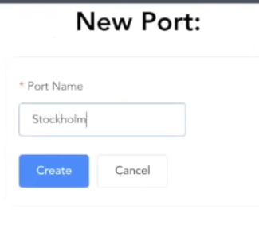
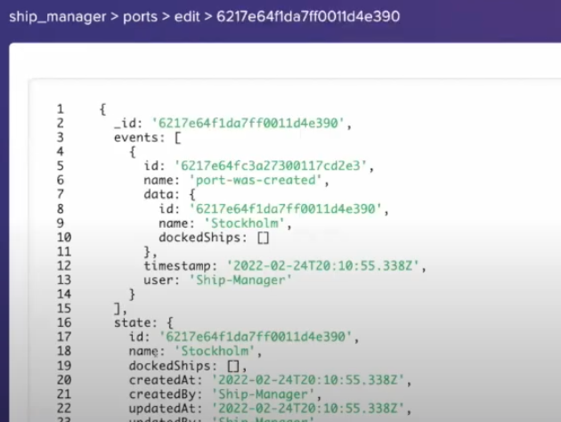
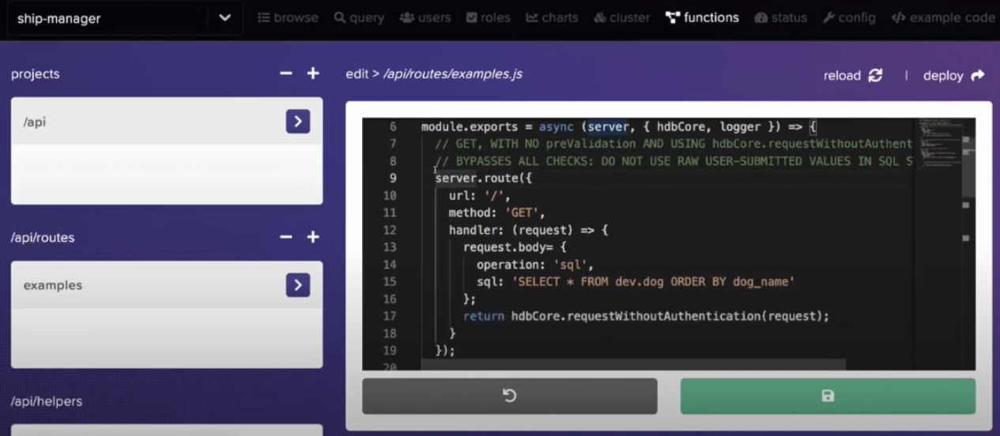

Há algumas semanas dei uma talk no canal do HarperDB sobre como podemos migrar uma aplicação legada do MongoDB para o HarperDB. Se você não viu, pode assistir aqui:


Este post vai ser um tutorial escrito do processo. Então, se você não pode assistir ao vídeo, ou quer guardar o conteúdo para outro momento, é isso que você procura.

- [Objetivo](#objetivo)
- [Setup](#setup)
- [Configurando o banco de dados](#configurando-o-banco-de-dados)
- [Migrando o código](#migrando-o-código)
  - [Entendendo a aplicação](#entendendo-a-aplicação)
  - [Criando o client](#criando-o-client)
  - [Migrando os repositórios](#migrando-os-repositórios)
  - [Ajustes finais](#ajustes-finais)
- [Testando](#testando)
- [Custom Functions](#custom-functions)

## Objetivo

Criei este tutorial porque este é um cenário real. Muita gente lida com aplicações legadas no dia a dia, e algumas das mudanças que precisam fazer incluem migrações de uma stack de tecnologia para outra.

É por isso que esta aplicação foi escolhida especificamente, porque é um exemplo real de como podemos migrar uma aplicação legada de uma stack de tecnologia para outra. Ela é velha, usa bibliotecas velhas e define nossos limites sobre onde **não** queremos mexer.

Neste caso, o objetivo é fazer a migração completa sem mexer em muito código, e sem ter que tocar em nenhum código que não queremos tocar. Por sorte, essa aplicação é implementada usando uma arquitetura mais ou menos MVC, então existem camadas sobre camadas, o que facilita abstrair a maior parte da funcionalidade para lugares separados e deixar o código mais legível. Além disso, isso permite que a gente altere só o código que queremos alterar, e não a aplicação inteira.

## Setup

Não vou explicar exatamente o que é o HarperDB ou como ele funciona, mas vou te mostrar como começar com o básico.

A primeira coisa que você precisa fazer é criar uma conta no [site do HarperDB](http://www.harperdb.com/). Isso vai te dar a possibilidade de usar o Harper Studio, que vai ser a ferramenta que usaremos para criar e gerenciar o banco de dados.

A segunda coisa é clonar o [repositório da aplicação](https://github.com/khaosdoctor/harperdb-migration-demo), a aplicação tem três branches:

- `main` é a branch onde vamos trabalhar.
- `migrated` é a branch com todo o trabalho feito, se você precisar espiar alguma coisa no fim do processo, pode usar essa branch.
- `migrated-custom-functions` é a branch que contém o código migrado, mais a implementação das custom functions.

Depois de clonar, a primeira coisa que você precisa fazer é ir até o diretório `backend` e rodar `npm install`. Isso vai instalar todas as dependências necessárias para rodar a aplicação.

> É bom ter o [Docker](https://docker.com) instalado também, já que vamos mexer com um frontend, um backend e um banco de dados. E vamos usar tudo dentro de um container com o Docker Compose.

## Configurando o banco de dados

A primeira coisa que precisamos fazer é configurar o banco de dados, neste caso, o Harper. Então vamos até o arquivo `docker-compose.yml`, que agora está assim:

```yml
version: '3.7'

services:
  backend:
    build: ./backend
    environment:
      DATABASE_MONGODB_URI: mongodb://database:27017
      DATABASE_MONGODB_DBNAME: ship_manager
      NODE_ENV: ${NODE_ENV:-development}
    ports:
      - '3000:3000'
    depends_on:
      - database

  # ... frontend stuff we don't care about ...

  database:
    image: mvertes/alpine-mongo
    ports:
      - '27017:27017'
    volumes:
      - mongodb:/data/db

volumes:
  mongodb:
```

Precisamos mudar o banco de dados para usar o Harper e o backend para refletir essa mudança. Primeiro vamos mudar o `services.database` para ficar assim:

```yml
database:
  image: harperdb/harperdb
  ports:
    - '9925:9925'
    - '9926:9926'
  volumes:
    - db:/opt/harperdb/hdb
  environment:
    - HDB_ADMIN_USERNAME=admin
    - HDB_ADMIN_PASSWORD=admin
    - CUSTOM_FUNCTIONS=true
```

Primeiro mudamos a imagem, para podermos baixar a última versão do Harper. Depois abrimos as duas portas, a da conexão com o banco e a das custom functions (que funciona na 9926); feito isso, configuramos nossos volumes para não perdermos os dados caso precisemos deletar o container; e por último, definimos as variáveis de ambiente do banco de dados.

> Estou usando senhas em texto puro aqui, mas o ideal é definir isso em tempo de execução.

Depois, vamos mudar o `services.backend` para ficar assim:

```yml
backend:
  build: ./backend
  environment:
    DATABASE_URI: http://database:9925
    DATABASE_DBNAME: ship_manager
    DATABASE_USERNAME: admin
    DATABASE_PASSWORD: admin
    NODE_ENV: ${NODE_ENV:-development}
  ports:
    - '3000:3000'
  depends_on:
    - database
```

A única mudança real que fizemos aqui foi alterar a URI do banco para usar a porta do banco de dados, e definir o usuário e a senha do banco.

E, no fim, precisamos mudar o nome do nosso volume, que era `mongodb`, para `db`.

```yml
volumes:
  db:
```

O arquivo final fica assim:

```yml
version: '3.7'

services:
  backend:
    build: ./backend
    environment:
      DATABASE_URI: http://database:9925
      DATABASE_DBNAME: ship_manager
      DATABASE_USERNAME: admin
      DATABASE_PASSWORD: admin
      NODE_ENV: ${NODE_ENV:-development}
    ports:
      - '3000:3000'
    depends_on:
      - database

  frontend:
    build: ./frontend
    ports:
      - '80:80'
    depends_on:
      - backend

  database:
    image: harperdb/harperdb
    ports:
      - '9925:9925'
      - '9926:9926'
    volumes:
      - db:/opt/harperdb/hdb
    environment:
      - HDB_ADMIN_USERNAME=admin
      - HDB_ADMIN_PASSWORD=admin
      - CUSTOM_FUNCTIONS=true

volumes:
  db:
```

Agora vá até [o studio do HarperDB](https://studio.harperdb.io), abra sua organização e adicione uma nova Instance. No menu modal, selecione "Register User-installed Instance" e preencha as seguintes informações:

- **Name**: ship-manager
- **Username and password**: admin
- **Host**: localhost
- **Port**: 9925
- **SSL**: No

Não clique em "Instance Deails" ainda, precisamos subir nossos containers primeiro. Então vá até seu terminal e digite `docker compose up -d database` para subir apenas a instância do banco, espere alguns segundos e rode `docker compose logs database` para conferir o log, ele deve estar pronto. Aí você pode clicar em "Instance Details", selecionar o free tier e confirmar.

A conexão vai levar alguns minutos para ser feita:



Assim que o status estiver "OK", abra o banco e crie um novo schema (o mesmo que você usou na variável de ambiente `DATABASE_DBNAME` do backend).



Depois da criação, vamos criar duas tabelas, uma chamada `ports` e outra chamada `ships`, ambas vão ter o "Hash Attribute" como `_id`:



Em seguida, vá até a aba "functions" na faixa preta no topo da página, e crie um novo projeto chamado `api`:



Isso vai habilitar e ativar as custom functions.

É só isso que precisamos fazer, agora podemos começar a codar a migração.

## Migrando o código

Para migrar o código existente precisamos entender um pouco da arquitetura por trás dele. Você tem alguma documentação no arquivo README, mas ela não explica todas as partes. Então vamos passar pelo código e ver o que precisamos fazer.

### Entendendo a aplicação

A aplicação é dividida em três partes dentro de `backend/src`:

- `data`: É o equivalente ao `model`, aqui é onde nos conectamos ao banco de dados, temos clients para trazer dados de fontes externas, e temos a lógica para interagir com o banco. Idealmente, este é o único lugar que precisamos mudar, já que todos os documentos aqui são retornados como instâncias de objetos de domínio como `Ship` e `Port`.
- `domain`: É o equivalente à `entity`, aqui é onde definimos os objetos de domínio, como `Ship` e `Port`.
- `services`: É o equivalente ao `controller`, aqui é onde definimos os serviços que interagem com os objetos de domínio.
- `presentation`: É o equivalente à `view`, aqui é onde definimos a camada de apresentação, as rotas ReST e todas as partes interativas da aplicação.

Também temos dois arquivos importantes, o entrypoint da nossa app em `backend/src/app.ts` e o arquivo de configuração em `backend/src/app-config.ts`. Vamos precisar mudar o arquivo `app-config.ts` primeiro para refletir as mudanças que fizemos no banco, é isso que devemos escrever:

```typescript
import env from 'sugar-env'

export const config = {
  cors: {
    exposedHeaders: ['x-content-range']
  },
  database: {
    harperdb: {
      uri: env.get('DATABASE_URI')!,
      dbName: env.get('DATABASE_DBNAME')!,
      username: env.get('DATABASE_USERNAME')!,
      password: env.get('DATABASE_PASSWORD')!
    }
  }
}
```

A próxima coisa que vamos fazer é mudar o arquivo `app.ts` para refletir o que queremos ter no fim. Este é o arquivo atual:

```ts
import routes from './routes'
import mongodb from '../data/connections/mongodb'
// Other imports...

export const app = expresso(async (app: Express, appConfig: typeof config) => {
  const connection = await mongodb.createConnection(appConfig.database.mongodb)

  const portRepository = new PortRepository(connection)
  const portService = new PortService(portRepository)

  const shipRepository = new ShipRepository(connection)
  const shipService = new ShipService(shipRepository, portService)

  // Routes...
})
```

Como você pode ver, estamos importando uma conexão com o MongoDB, e passando ela adiante para os repositórios, então essa é a parte que precisamos mudar, vamos precisar remover o mongo por completo e substituir pelo client do harperdb.

A forma como queremos fazer isso é ter uma classe `HarperDBClient`, que vai ser o equivalente à conexão do `mongodb`, e vamos usá-la para dar aos repositórios uma conexão válida com a API do Harper.

Esse client deve apenas pegar a config do HarperDB presente no `app-config.ts` e nos dar uma conexão válida com a API. Então vamos escrever isso:

```ts
import routes from './routes'
import type { config } from '../app-config'
import { HarperDBClient } from '../data/clients/HarperDBClient'
// Other imports...

export const app = expresso(async (app: Express, appConfig: typeof config) => {
  const client = new HarperDBClient(appConfig.database.harperdb)

  const portRepository = new PortRepository(client)
  const portService = new PortService(portRepository)

  const shipRepository = new ShipRepository(client)
  const shipService = new ShipService(shipRepository, portService)

  // Routes...
})
```

E podemos remover completamente o import do `mongodb`, e substituir pela classe `HarperDBClient`.

Depois disso, podemos começar a codar nosso client!

### Criando o client

Para começar a criar nosso client, vamos precisar primeiro deletar o arquivo `mongodb` dentro de `data/connections` e substituir por um `HarperDBClient` dentro de `data/clients`. Esse arquivo vai ser uma classe que vai implementar a interface `HarperDBClient`.

A primeira coisa que vamos fazer é instalar o pacote `axios` com `npm install axios`. Depois vamos começar criando uma classe que recebe a config do HarperDB e implementa a interface `HarperDBClient`:

```ts
import { config } from '../../app-config'
import Axios, { AxiosInstance } from 'axios'

export class HarperDBClient {
  #client: AxiosInstance
  #schema: string = ''

  constructor(connectionConfig: typeof config.database.harperdb) {
    this.#client = Axios.create({
      baseURL: connectionConfig.uri,
      url: '/',
      auth: {
        username: connectionConfig.username,
        password: connectionConfig.password
      },
      headers: {
        'Content-Type': 'application/json'
      }
    })
    this.#schema = connectionConfig.dbName
  }
}
```

O que estamos fazendo aqui é só criar o client inicial que vai ser usado em todas as chamadas ReST internas da API.

> **Nota:** Você pode usar `import type { config } from '../app-config'` para importar somente os tipos também.

Agora vamos criar a primeira função, que vai ser usada para listar todas as entidades de uma dada entidade. Isso vai ser feito usando nosso bom e velho SQL. Mas também queremos tipar isso direitinho! Então vamos criar uma função que vai retornar uma lista de entidades:

```ts
async SQLFindAll<Entity> (tableName: string, projection: string = '*', whereClause: string = '') {
  const { data } = await this.#client.post<Entity[]>('/', {
    operation: 'sql',
    sql: `SELECT ${projection} FROM ${this.#schema}.${tableName} ${whereClause ? `WHERE ${whereClause}` : ''}`
  })
  return data
}
```

Nesta função estamos recebendo um parâmetro de tipo que é a entidade que estamos retornando. Os outros parâmetros especificam o nome da tabela, os campos que queremos retornar, e a cláusula where.

Todas as chamadas à API do Harper são feitas para a rota raiz, e todas são requisições POST. O que realmente define nossa ação é o payload daquela requisição, então vamos usar o método `post` do `client` para fazer a chamada. O que vai retornar uma lista da entidade dada.

A próxima coisa que vamos fazer é criar uma função que vai retornar uma única entidade, é bem parecida com a de cima, mas neste caso vamos usar uma função nativa do HarperDB chamada `search_by_hash`:

```ts
async NoSQLFindByID<Entity> (recordID: string | number, tableName: string, projection: string[] = ['*']) {
  const { data } = await this.#client.post<Entity[]>('/', {
    operation: 'search_by_hash',
    table: tableName,
    schema: this.#schema,
    hash_values: [recordID],
    get_attributes: projection
  })
  return data[0]
}
```

Nesta função, vamos receber apenas o ID do registro, o nome da tabela, e os campos que queremos retornar. Como você pode ver, o payload da requisição mudou bastante. Também vamos receber uma lista de campos para retornar, mas vamos usar o `*` para pegar todos os campos por padrão.

Outro ponto importante de notar é que, mesmo retornando uma única entidade, o Harper devolve um array daquela entidade na resposta. Então vamos precisar fatiar o array para pegar o primeiro elemento.

Para a próxima função vamos precisar criar alguns tipos mais complicados, são as funções `update` e `upsert`, a diferença entre elas e as outras é que elas têm um tipo de retorno diferente para cada chamada. Então o que vamos fazer é criar um tipo base e estendê-lo conforme a necessidade.

Vamos adicionar isso no topo do nosso arquivo:

```ts
interface HarperNoSQLReturnTypeBase {
  message: string
  skipped_hashes: string[]
}

interface HarperNoSQLUpsertType extends HarperNoSQLReturnTypeBase {
  upserted_hashes: any[]
}

interface HarperNoSQLUpdateType extends HarperNoSQLReturnTypeBase {
  updated_hashes: any[]
}
```

Agora temos o tipo base e os estendidos, tudo que precisamos fazer é criar um tipo que vai juntar os dois, e escolher o certo com base na chamada da função:

```ts
type HarperNoSQLReturnType<T> = T extends 'upsert'
  ? HarperNoSQLUpsertType
  : T extends 'update'
  ? HarperNoSQLUpdateType
  : never
```

Esse tipo vai checar se um dado parâmetro de tipo é `upsert` ou `update`, e vai retornar o tipo certo com base nisso.

E podemos usá-lo nas nossas funções:

```ts
async NoSQLUpsert (records: Object[], tableName: string) {
  const { data } = await this.#client.post<HarperNoSQLReturnType<'upsert'>>('/', {
    operation: 'upsert',
    table: tableName,
    schema: this.#schema,
    records
  })
  return data
}

async NoSQLUpdate (records: Record<string, any>, tableName: string) {
  const { data } = await this.#client.post<HarperNoSQLReturnType<'update'>>('/', {
    operation: 'update',
    table: tableName,
    schema: this.#schema,
    records
  })
  return data
}
```

> Mesmo que não vamos usar a função `update`, achei que seria legal adicioná-la aqui para podermos ver como ela funciona.

E é isso, nosso client já está pronto para ser usado! É assim que ele fica:

```ts
import { config } from '../../app-config'
import Axios, { AxiosInstance } from 'axios'

interface HarperNoSQLReturnTypeBase {
  message: string
  skipped_hashes: string[]
}

interface HarperNoSQLUpsertType extends HarperNoSQLReturnTypeBase {
  upserted_hashes: any[]
}

interface HarperNoSQLUpdateType extends HarperNoSQLReturnTypeBase {
  updated_hashes: any[]
}

type HarperNoSQLReturnType<T> = T extends 'upsert'
  ? HarperNoSQLUpsertType
  : T extends 'update'
  ? HarperNoSQLUpdateType
  : never

export class HarperDBClient {
  #client: AxiosInstance
  #schema: string = ''

  constructor(connectionConfig: typeof config.database.harperdb) {
    this.#client = Axios.create({
      baseURL: connectionConfig.uri,
      url: '/',
      auth: {
        username: connectionConfig.username,
        password: connectionConfig.password
      },
      headers: {
        'Content-Type': 'application/json'
      }
    })
    this.#schema = connectionConfig.dbName
  }

  async SQLFindAll<Entity>(tableName: string, projection: string = '*', whereClause: string = '') {
    const { data } = await this.#client.post<Entity[]>('/', {
      operation: 'sql',
      sql: `SELECT ${projection} FROM ${this.#schema}.${tableName} ${whereClause ? `WHERE ${whereClause}` : ''}`
    })
    return data
  }

  async NoSQLUpsert(records: Object[], tableName: string) {
    const { data } = await this.#client.post<HarperNoSQLReturnType<'upsert'>>('/', {
      operation: 'upsert',
      table: tableName,
      schema: this.#schema,
      records
    })
    return data
  }

  async NoSQLUpdate(records: Record<string, any>, tableName: string) {
    const { data } = await this.#client.post<HarperNoSQLReturnType<'update'>>('/', {
      operation: 'update',
      table: tableName,
      schema: this.#schema,
      records
    })
    return data
  }

  async NoSQLFindByID<Entity>(recordID: string | number, tableName: string, projection: string[] = ['*']) {
    const { data } = await this.#client.post<Entity[]>('/', {
      operation: 'search_by_hash',
      table: tableName,
      schema: this.#schema,
      hash_values: [recordID],
      get_attributes: projection
    })
    return data[0]
  }
}
```

### Migrando os repositórios

Se você olhar de perto o diretório `data/repositories`, vai ver que existem dois repositórios, um para a entidade `Ship` e um para a entidade `Port`. Se você abrir um deles vai ver que são quase iguais entre si:

```ts
import { Db } from 'mongodb'
import { MongodbEventRepository } from '@irontitan/paradox'
import { Port } from '../../domain/port/entity'

export class PortRepository extends MongodbEventRepository<Port> {
  constructor(connection: Db) {
    super(connection.collection(Port.collection), Port)
  }

  async getAll(): Promise<Port[]> {
    const documents = await this._collection.find({ 'state.deletedAt': null }).toArray()
    return documents.map(({ events }) => {
      const port = new Port()
      return port.setPersistedEvents(events)
    })
  }
}
```

A única mudança é o nome da entidade. Então por que não usamos herança de classes para facilitar isso? Vamos criar uma classe `BaseRepository` que vai ser estendida pelas classes `PortRepository` e `ShipRepository`.

Primeiro, precisamos estar de acordo com as bibliotecas de event sourcing que estamos usando, o [paradox](https://github.com/irontitan/paradox) é uma biblioteca que tem uma classe `MongodbEventRepository` que podemos estender no código original, como não estamos mais usando o Mongo, precisamos checar como a biblioteca estende o código, e se você olhar [o código dela](https://github.com/irontitan/paradox/blob/master/src/classes/repositories/MongodbEventRepository.ts#L13) vai ver que ela usa um parâmetro de tipo para especificar o tipo da entidade, e estende a classe `EventRepository` com aquele tipo:

```ts
export abstract class MongodbEventRepository<TEntity extends IEventEntity> extends EventRepository<TEntity>
```

Não podemos estender a classe `EventRepository` diretamente porque ela foi feita para bancos de dados NoSQL, então vamos estender a entidade diretamente:

```ts
export class BaseRepository<Entity extends IEventEntity> {}
```

Nosso construtor é simples, vamos apenas criar três variáveis protegidas. Uma vai ser a entidade com a qual estamos trabalhando, porque precisamos saber que tipo de classe criar; a segunda vai ser o client do banco de dados, que é nosso client do HarperDB; e a última é o nome da tabela.

```ts
import { HarperDBClient } from '../clients/HarperDBClient'
import { IEventEntity } from '@irontitan/paradox'
import { IEntityConstructor } from '@irontitan/paradox/dist/interfaces/IEntityConstructor'

export class BaseRepository<Entity extends IEventEntity> {
  protected database: HarperDBClient
  protected tableName: string
  protected entity: IEntityConstructor<Entity>
  constructor(client: HarperDBClient, tableName: string, entity: IEntityConstructor<Entity>) {
    this.database = client
    this.tableName = tableName
    this.entity = entity
  }
}
```

Depois precisamos dar uma olhada nas funções que são usadas pelos services, vamos ver que temos três principais: `getAll`, `save` e `findById`. Vamos criá-las no nosso repositório base, estas são as regras:

- `getAll` vai retornar todas as entidades da tabela.
- `save` vai salvar uma nova entidade ou atualizar uma existente.
- `findById` vai retornar uma entidade pelo seu ID.

Começando pela mais simples, `getAll`, vamos apenas chamar a função `SQLFindAll` do client do banco, e vamos passar o nome da tabela e a projeção.

```ts
async getAll (): Promise<Entity[]> {
  const documents = await this.database.SQLFindAll<{ events: Entity['events'] }>(this.tableName, 'events', `search_json('deletedAt', state) IS NULL`)
  return documents.map((document) => new this.entity().setPersistedEvents(document.events))
}
```

No fim da função, precisamos pegar a lista de eventos que retornamos e adicioná-los à sua entidade, depois retornar a entidade, que vai conter o reducer para aplicar os eventos à entidade.

O único detalhe aqui são as tipagens, como estamos interessados somente nos eventos, vamos usar `{ events: Entity['events'] }` como o tipo do documento. E depois vamos usar a função `search_json` para filtrar as entidades deletadas.

> Esta segunda parte é importante porque, em event sourcing, nunca deletamos nada de verdade, apenas adicionamos um evento de delete que vai preencher um campo `deletedAt` na entidade. Então, se queremos pegar todas as entidades, vamos precisar filtrar as deletadas.

Em seguida, vamos para a função `findById`. Essa vai ser um pouco mais complicada já que estamos usando MongoDB com ObjectIDs, então esperamos esse tipo de objeto no nosso código. Então precisamos continuar usando eles.

> É uma boa prática remover todos os OIDs do código e usar outro tipo de identificador, como UUIDs, para que possamos trocar de banco de dados facilmente. Principalmente porque o Harper não entende OIDs como um Object, e sim como uma string.

Nossa função vai precisar chamar a função `NoSQLFindByID` do client do banco, e vamos passar o nome da tabela, o ID do registro e a projeção, e ela deve retornar null caso a entidade não exista.

```ts
async findById (id: string | ObjectId): Promise<Entity | null> {
  if (!ObjectId.isValid(id)) return null

  const document = await this.database.NoSQLFindByID<Entity>(id.toString(), this.tableName, ['state', 'events'])
  if (!document) return null

  return new this.entity().setPersistedEvents(document.events)
}
```

A última função é a `save`, que vai ser um pouco mais complicada. Vamos precisar chamar a função `NoSQLUpsert` do client do banco, e vamos passar o nome da tabela e a entidade a ser feito o upsert. Mas não podemos usar a entidade diretamente, precisamos cloná-la, então vamos instalar o `lodash.clonedeep` usando `npm install lodash.clonedeep`.

Depois, vamos importá-lo como `import cloneDeep from 'lodash.clonedeep'`. E usá-lo assim:

```ts
async save (entity: Entity): Promise<Entity> {
  const localEntity = cloneDeep(entity)
  const document = {
    _id: entity.id,
    state: localEntity.state,
    events: localEntity.persistedEvents.concat(localEntity.pendingEvents)
  }
  const result = await this.database.NoSQLUpsert([document], this.tableName)
  if (!result.upserted_hashes.includes(document._id.toString())) throw new Error(result.message)
  return localEntity.confirmEvents()
}
```

Estamos montando o documento dentro da função, depois concatenando os eventos pendentes (eventos que estão na entidade, mas ainda não persistidos no banco) aos eventos persistidos (eventos que já estão persistidos no banco). Depois vamos chamar a função `NoSQLUpsert` do client do banco, e vamos passar o nome da tabela e o documento a ser feito o upsert.

Também podemos checar o ID inserido para ter certeza e, no fim, vamos confirmar os eventos, o que essencialmente vai concatenar os eventos pendentes aos eventos persistidos, e limpar o array de eventos pendentes.

O código final fica assim:

```ts
import { HarperDBClient } from '../clients/HarperDBClient'
import { ObjectId } from 'mongodb'
import { IEventEntity } from '@irontitan/paradox'
import { IEntityConstructor } from '@irontitan/paradox/dist/interfaces/IEntityConstructor'
import cloneDeep from 'lodash.clonedeep'

export class BaseRepository<Entity extends IEventEntity> {
  protected database: HarperDBClient
  protected tableName: string
  protected entity: IEntityConstructor<Entity>
  constructor(client: HarperDBClient, tableName: string, entity: IEntityConstructor<Entity>) {
    this.database = client
    this.tableName = tableName
    this.entity = entity
  }

  async findById(id: string | ObjectId): Promise<Entity | null> {
    if (!ObjectId.isValid(id)) return null

    const document = await this.database.NoSQLFindByID<Entity>(id.toString(), this.tableName, ['state', 'events'])
    if (!document) return null

    return new this.entity().setPersistedEvents(document.events)
  }

  async save(entity: Entity): Promise<Entity> {
    const localEntity = cloneDeep(entity)
    const document = {
      _id: entity.id,
      state: localEntity.state,
      events: localEntity.persistedEvents.concat(localEntity.pendingEvents)
    }
    const result = await this.database.NoSQLUpsert([document], this.tableName)
    if (!result.upserted_hashes.includes(document._id.toString())) throw new Error(result.message)
    return localEntity.confirmEvents()
  }

  async getAll(): Promise<Entity[]> {
    const documents = await this.database.SQLFindAll<{ events: Entity['events'] }>(
      this.tableName,
      'events',
      `search_json('deletedAt', state) IS NULL`
    )
    return documents.map((document) => new this.entity().setPersistedEvents(document.events))
  }
}
```

Depois é só estender essa classe nos nossos outros repositórios, assim:

```ts
import { HarperDBClient } from '../clients/HarperDBClient'
import { BaseRepository } from './BaseRepository'
import { Port } from '../../domain'

export class PortRepository extends BaseRepository<Port> {
  constructor(client: HarperDBClient) {
    super(client, 'ports', Port)
  }
}
```

E o repositório de ship vai ficar assim:

```ts
import { Ship } from '../../domain/ship/entity'
import { HarperDBClient } from '../clients/HarperDBClient'
import { BaseRepository } from './BaseRepository'

export class ShipRepository extends BaseRepository<Ship> {
  constructor(client: HarperDBClient) {
    super(client, 'ships', Ship)
  }
}
```

### Ajustes finais

Como mencionei antes, estamos usando MongoDB com ObjectIDs, então esperamos esse tipo de objeto no nosso código. Mas o Harper não entende esses OIDs como Objects, e sim como strings.

O problema é que a biblioteca `ObjectId` tem duas funções, a `equals` e a `toHexString`, e elas não existem em strings, então precisamos mudar toda ocorrência dessas funções para `.toString()`.

Se você buscar no seu editor pela palavra `.equals` vai encontrar três arquivos com 4 ocorrências. Vamos substituí-las por `.toString()` e a comparação com `equals` vai virar a boa e velha comparação com `===`.

`domain/port/events/ShipDockedEvent.ts`:

**Antes:**

```ts
import { Event } from '@irontitan/paradox'
import { Port } from '../entity'
import { ObjectId } from 'mongodb'

interface IEventCreationParams {
  shipId: ObjectId
}

export class ShipDockedEvent extends Event<IEventCreationParams> {
  // ...

  static commit(state: Port, event: ShipDockedEvent): Port {
    if (!state.dockedShips.find((shipId) => shipId.equals(event.data.shipId))) state.dockedShips.push(event.data.shipId)
    state.updatedAt = event.timestamp
    state.updatedBy = event.user
    return state
  }
}
```

**Depois:**

```ts
import { Event } from '@irontitan/paradox'
import { Port } from '../entity'
import { ObjectId } from 'mongodb'

interface IEventCreationParams {
  shipId: ObjectId
}

export class ShipDockedEvent extends Event<IEventCreationParams> {
  // ...

  static commit(state: Port, event: ShipDockedEvent): Port {
    if (!state.dockedShips.find((shipId) => shipId.toString() === event.data.shipId.toString()))
      state.dockedShips.push(event.data.shipId)
    state.updatedAt = event.timestamp
    state.updatedBy = event.user
    return state
  }
}
```

---

`/domain/ship/events/ShipUndockedEvent.ts`:

**Antes:**

```ts
import { Event } from '@irontitan/paradox'
import { Port } from '../entity'
import { ObjectId } from 'mongodb'

interface IEventCreationParams {
  shipId: ObjectId
  reason: string
}

export class ShipUndockedEvent extends Event<IEventCreationParams> {
  // ...

  static commit(state: Port, event: ShipUndockedEvent): Port {
    state.dockedShips = state.dockedShips.filter((shipId) => !event.data.shipId.equals(shipId))
    state.updatedAt = event.timestamp
    state.updatedBy = event.user
    return state
  }
}
```

**Depois:**

```ts
import { Event } from '@irontitan/paradox'
import { Port } from '../entity'
import { ObjectId } from 'mongodb'

interface IEventCreationParams {
  shipId: ObjectId
  reason: string
}

export class ShipUndockedEvent extends Event<IEventCreationParams> {
  // ...

  static commit(state: Port, event: ShipUndockedEvent): Port {
    state.dockedShips = state.dockedShips.filter((shipId) => event.data.shipId.toString() !== shipId.toString())
    state.updatedAt = event.timestamp
    state.updatedBy = event.user
    return state
  }
}
```

---

`services/PortService.ts`:

**Antes:**

```ts
import { ObjectId } from 'mongodb'
import { Port, Ship } from '../domain'
import { PortRepository } from '../data/repositories/PortRepository'
import { PortNotFoundError } from '../domain/port/errors/PortNotFoundError'
import { IPortCreationParams } from '../domain/structures/IPortCreationParams'

export class PortService {
  // ...

  async undockShip(ship: Ship, reason: string, user: string): Promise<void> {
    if (!ship.currentPort) return

    const port = await this.repository.findById(ship.currentPort)
    if (!port) return
    if (!port.dockedShips.find((dockedShip) => dockedShip.equals(ship.id as ObjectId))) return

    port.undockShip(ship, reason, user)

    await this.repository.save(port)
  }

  async dockShip(ship: Ship, user: string): Promise<void> {
    if (!ship.currentPort) return

    const port = await this.repository.findById(ship.currentPort)

    if (!port) throw new PortNotFoundError(ship.currentPort.toHexString())
    if (port.dockedShips.find((dockedShip) => dockedShip.equals(ship.id as ObjectId))) return

    port.dockShip(ship, user)
    await this.repository.save(port)
  }

  // ...
}
```

**Depois:**

```ts
import { ObjectId } from 'mongodb'
import { Port, Ship } from '../domain'
import { PortRepository } from '../data/repositories/PortRepository'
import { PortNotFoundError } from '../domain/port/errors/PortNotFoundError'
import { IPortCreationParams } from '../domain/structures/IPortCreationParams'

export class PortService {
  // ...

  async undockShip(ship: Ship, reason: string, user: string): Promise<void> {
    if (!ship.currentPort) return

    const port = await this.repository.findById(ship.currentPort)
    if (!port) return
    if (!port.dockedShips.find((dockedShip) => dockedShip.toString() === ship.id?.toString())) return

    port.undockShip(ship, reason, user)

    await this.repository.save(port)
  }

  async dockShip(ship: Ship, user: string): Promise<void> {
    if (!ship.currentPort) return

    const port = await this.repository.findById(ship.currentPort)

    if (!port) throw new PortNotFoundError(ship.currentPort.toString())
    if (port.dockedShips.find((dockedShip) => dockedShip.toString() === ship.id?.toString())) return

    port.dockShip(ship, user)
    await this.repository.save(port)
  }

  // ...
}
```

## Testando

Agora terminamos! Vamos testar a aplicação executando o arquivo do docker compose com `docker compose up` e navegando até `localhost`:



Vamos criar um novo port e ver como fica:



E conferir no harper:



## Custom Functions

Para incluir as custom functions, vamos mudar a aba `functions` no Harper Studio para incluir o seguinte código:

```js
'use strict'

// eslint-disable-next-line no-unused-vars,require-await
module.exports = async (server, { hdbCore }) => {
  server.route({
    url: '/ships',
    method: 'GET',
    preParsing: (request, _, done) => {
      request.body = {
        operation: 'sql',
        sql: 'SELECT events FROM ship_manager.ships WHERE search_json("deletedAt", state) IS NULL'
      }
      done()
    },
    preValidation: hdbCore.preValidation,
    handler: hdbCore.request
  })

  server.route({
    url: '/ports',
    method: 'GET',
    handler: (request) => {
      request.body = {
        operation: 'sql',
        sql: 'SELECT events FROM ship_manager.ports WHERE search_json("deletedAt", state) IS NULL'
      }
      return hdbCore.requestWithoutAuthentication(request)
    }
  })
}
```

Vamos colocar isso dentro do arquivo de exemplo, dentro do projeto que criamos antes:



O que isso vai fazer é adicionar uma nova rota ao servidor que vai nos permitir consultar os ships e os ports diretamente, sem a necessidade da query SQL dentro de `/ships` ou `/ports`.

Depois de salvar o arquivo, vamos voltar ao nosso client do HarperDB e mudar a função `findAll` para chamar a nova porta e a nova rota de entidade:

```ts
async SQLFindAll<Entity> (tableName: string) {
  const url = `${this.#client.defaults.baseURL?.replace('9925', '9926')}/api/${tableName}`
  const { data } = await Axios.get<Entity[]>(url, { auth: this.#client.defaults.auth })
  return data
}
```

Agora podemos subir nosso servidor com `docker compose up --build=backend` e navegar até `localhost` para ver que tudo está funcionando como esperado.
