_Foto de <a href="https://unsplash.com/@trommelkopf?utm_source=unsplash&utm_medium=referral&utm_content=creditCopyText">Steve Harvey</a> no <a href="https://unsplash.com/s/photos/broadcast?utm_source=unsplash&utm_medium=referral&utm_content=creditCopyText">Unsplash</a>_

Nos artigos anteriores que escrevi sobre o HarperDB, exploramos os mundos do [Kubernetes](https://medium.com/@khaosdoctor/using-harperdb-with-kubernetes-e796ea606e99) e do [Helm](https://faun.pub/running-harperdb-in-kubernetes-in-one-command-8c87e2788eb6). Agora é hora de dar um passo atrás e tentar entender outra funcionalidade bacana que ele oferece, neste artigo curto e direto ao ponto.

Vamos imaginar que trabalhamos numa empresa que fornece business intelligence sobre processos produtivos para grandes fábricas no mundo todo e você está lançando um produto novo: fábricas inteligentes! Para isso, as fábricas seriam equipadas com os mais variados tipos de sensores que monitoram várias propriedades importantes das máquinas, como pressão, temperatura e peso colocado sobre elas.

O problema é que todos esses dados precisam ser enviados de volta para os servidores principais da empresa para que possamos aplicar nossos modelos de machine learning e análises de big data em cima deles. E te pediram para desenhar uma arquitetura bacana para que isso aconteça. O processo tem algumas regras:

* Os sensores enviam dados a uma taxa muito alta, então mandá-los conforme são recebidos não seria sábio, porque entupiria a rede, tornando o streaming de dados uma solução sub-ótima.
* Os dados devem ser armazenados em um banco de dados na empresa em formato bruto.
* Os sensores vão continuar enviando dados mesmo em caso de falha de rede. Você precisa sincronizar esses dados com os servidores da empresa assim que a rede voltar.
* A empresa precisa conseguir enviar configurações para os sensores instalados nos clientes a partir da matriz, sem precisar de uma visita local.

Como fazer todas essas tarefas com o mínimo de esforço e usando a melhor tecnologia? Entram os **clusters do HarperDB**.

## Clusters

Quando falamos em clusters, a ideia base que nos vem à cabeça é algo como Kubernetes, certo? Um monte de máquinas virtuais que se comportam como uma só, grandona. Só que o HarperDB leva essa ideia um passo adiante. Já que estamos falando de um banco de dados, o conceito de "funcionar como um só" se resume a ter os mesmos dados em todas as instâncias eventualmente, e esse é, de fato, o conceito de um cluster de bancos de dados.

Porém, em outros bancos, todos os dados vão ser replicados por todo o cluster de qualquer jeito, eles vão ser idênticos eventualmente, então por que você não poderia escolher quais dados quer sincronizar?

Quando você junta duas ou mais instâncias de um banco HarperDB em cluster, elas vão te perguntar quais dados você quer compartilhar, e isso é chamado de **subscription**. Então, basicamente, o que o HarperDB tem é uma implementação muito sólida e elegante de um modelo publish/subscribe que funciona no nível da tabela e tem um mecanismo tolerante a falhas que permite perder a conexão a qualquer momento e re-sincronizar os dados automaticamente assim que ela volta.

### Como os clusters funcionam?


Não vou me estender muito nessa parte porque o HarperDB tem uma [documentação muito boa sobre isso](https://harperdb.io/docs/clustering/), mas a ideia é que cada banco de dados compõe um **nó** no cluster, e todo o grupo de nós de um cluster junto com suas configurações é chamado de **topologia**.

Para enviar e receber dados, os nós dependem de **canais**, que são nomeados como `schema:table`, e cada canal representa uma conexão entre dois nós, enviando ou recebendo dados de uma tabela específica. Canais têm duas opções: eles podem ser **publishers**, **subscribers**, ou ambos.

Um canal de **publish** vai postar todas as mudanças daquela tabela específica para qualquer outro nó que esteja **inscrito nele**, vamos ver um exemplo. Se eu quisesse publicar todas as mudanças do schema chamado _dev_ na tabela _dog_ do primeiro nó para o segundo, eu poderia criar um **canal de publish** chamado `dev:dog`.

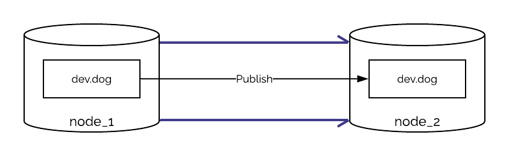

Por outro lado, eu poderia expressar isso de outra forma, poderia dizer que quero escutar todas as mudanças na tabela _dog_ no nó 1, então posso **me inscrever nela**:

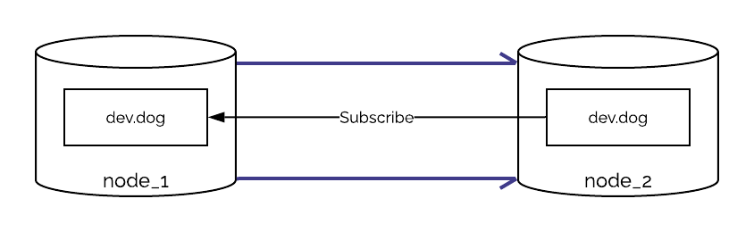

Quando você cria uma subscription em qualquer nó, qualquer mudança naquela tabela em particular vai ser sincronizada com as outras tabelas, qualquer dado novo em `dev:dog` vai ser publicado para o outro nó, assim como qualquer atualização ou remoção. Se a tabela não existir em um dos nós, ela também vai ser criada, porém, **operações destrutivas como `drop` não vão ser propagadas.**

### Criando um cluster

Então, você decide criar uma prova de conceito para ver se a sua ideia de usar os clusters do HarperDB vai funcionar. Como o HarperDB tem uma imagem Docker com clustering disponível, vamos começar criando um arquivo do Docker Compose.

A ideia é simular duas instâncias de um nó HarperDB e conectar as duas em um cluster. Para isso vamos criar dois serviços no seu Docker Compose, o primeiro vai ser o que representa o sensor:


```yaml
services:
harper-edge:
image: harperdb/harperdb
container_name: harper-edge
ports:
- "9900:9925"
- "9901:9926"
- "62000:62344"
    environment:
    - HDB_ADMIN_USERNAME=admin
      - HDB_ADMIN_PASSWORD=admin
      - CLUSTERING=true
      - CLUSTERING_USER=cluster
      - CLUSTERING_PASSWORD=cluster
      - CLUSTERING_PORT=62344
      - NODE_NAME=harper-edge
```


Vamos abrir as portas 9925, 9926 e 62344, mas como vamos subir outro serviço no mesmo computador, não dá para usar as mesmas portas, então vamos mapeá-las para 9900, 9901 e 6200 respectivamente. Vamos habilitar o clustering nas variáveis de ambiente, depois vamos definir a porta do cluster como 62344, igual definimos no manifesto de portas. Por fim, vamos nomear o nó como _harper-edge_.

Para a segunda instância, que vai representar o servidor da empresa, vamos copiar a primeira parte e só mudar os nomes e as portas, o arquivo final vai ficar assim:


```yaml
services:
  harper-edge:
    image: harperdb/harperdb
    container_name: harper-edge
    ports:
      - "9900:9925"
      - "9901:9926"
      - "62000:62344"
    environment:
      - HDB_ADMIN_USERNAME=admin
      - HDB_ADMIN_PASSWORD=admin
      - CLUSTERING=true
      - CLUSTERING_USER=cluster
      - CLUSTERING_PASSWORD=cluster
      - CLUSTERING_PORT=62344
      - NODE_NAME=harper-edge

  harper-host:
    image: harperdb/harperdb
    container_name: harper-host
    ports:
      - "9902:9925"
      - "9903:9926"
      - "62001:62344"
    environment:
      - HDB_ADMIN_USERNAME=admin
      - HDB_ADMIN_PASSWORD=admin
      - CLUSTERING=true
      - CLUSTERING_USER=cluster
      - CLUSTERING_PASSWORD=cluster
      - CLUSTERING_PORT=62344
      - NODE_NAME=harper-host
```


Estamos só somando 1 nas portas para que não haja conflito, e também mudando o nome do nó. A parte importante aqui é que o usuário e a senha do cluster **precisam ser os mesmos nos dois serviços**.

Vamos subir isso com `docker compose up`, você deve ver o resultado de duas instâncias do HarperDB sendo executadas. Agora vamos até o [HarperDB Studio](https://studio.harperdb.io/) e registrá-las. Basta criar sua conta, sua organização, e clicar em registrar uma nova instância gerenciada pelo usuário. Estes devem ser os dados que temos:

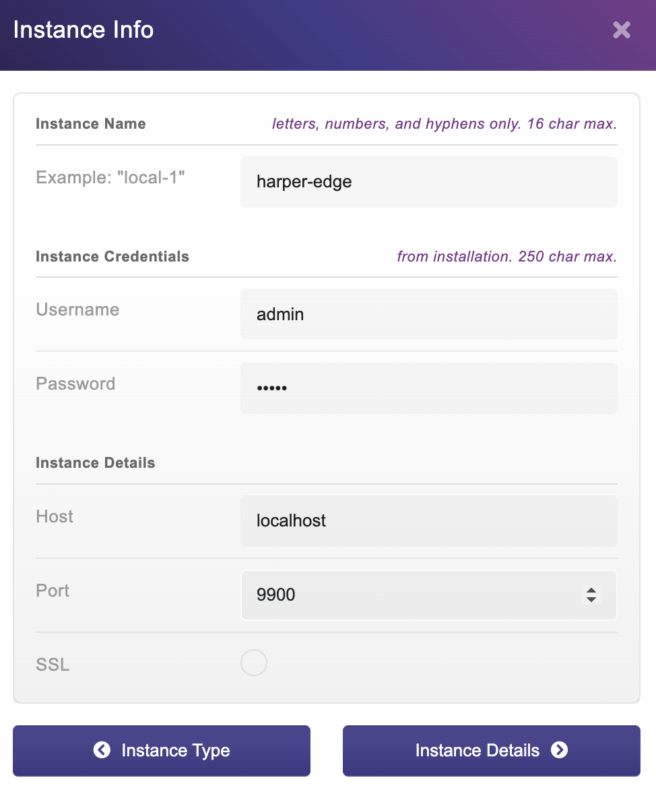

Selecione a instância gratuita e aceite os termos, e já devemos estar prontos:


Vamos fazer o mesmo com a outra:

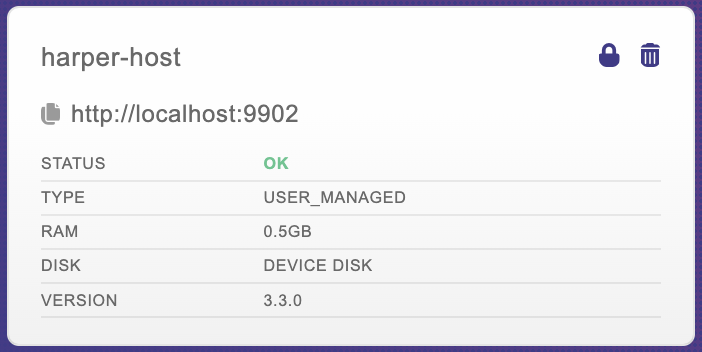

O que vai mudar é só o número da porta, que agora é 9902.

### Conectando os nós

Não vamos criar nenhuma tabela em nenhuma das instâncias. Em vez disso, vamos pular para o nosso studio e ir até a aba "Cluster" em qualquer uma delas:

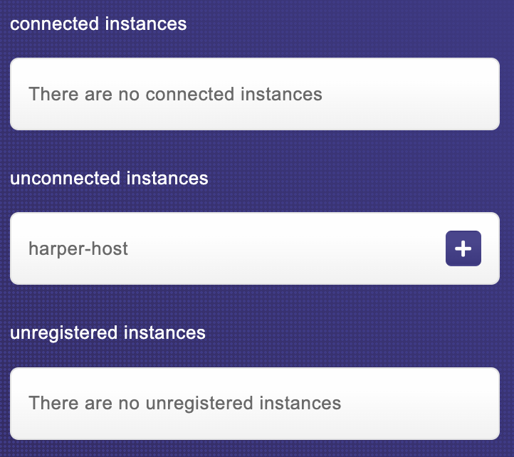
 

Como você pode ver, temos nosso outro nó listado, mas quando tentamos conectar recebemos um erro:

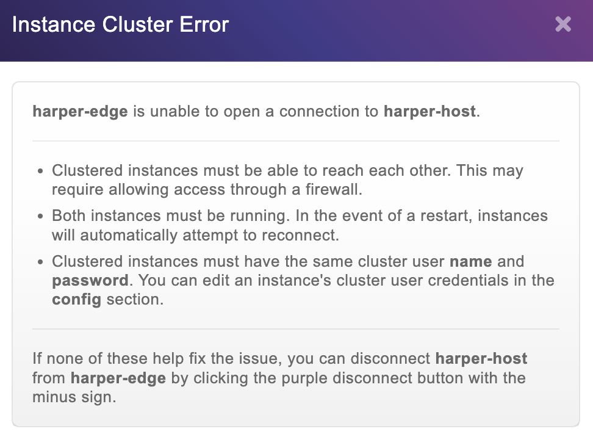

Como estamos usando Docker, a instância não está disponível através do HarperDB Studio para ser conectada ao outro nó no cluster, nesse caso, vamos precisar colocar a mão na massa, literalmente.

O HarperDB tem uma API que permite criar manualmente uma conexão entre dois nós. Em qualquer ferramenta de requisições que você tenha, como Postman, Insomnia ou qualquer outra, use a URL: `http://localhost:9902` em uma requisição POST. Você pode usar qualquer um dos hosts para fazer o que vamos fazer, mas para manter a ideia do projeto, vamos conectar ao host que representa o banco de dados da empresa.

Na seção de auth, vamos usar um HTTP auth básico, o usuário e a senha são os que definimos no arquivo do compose, nesse caso os dois são `admin`. Agora vamos criar um corpo JSON parecido com isto:

```json
{
  "operation": "add_node",
  "name": "harper-edge",
  "host": "harper-edge",
  "port": 62344,
  "subscriptions": [] 
}
```

Então, a partir do banco de dados da empresa, queremos **publicar** configurações e **nos inscrever** nos dados dos sensores, vamos dizer isso ao nó com dois objetos dentro da chave `subscriptions`:


```json
{
  "operation": "add_node",
  "name": "harper-edge",
  "host": "harper-edge",
  "port": 62344,
  "subscriptions": [
    {
      "channel": "default:sensor_data",
      "subscribe": true,
      "publish": false
    },
        {
      "channel": "default:configs",
      "subscribe": false,
      "publish": true
    }
  ] 
}
```

Agora, voltamos ao nosso studio e entramos na instância **harper-host**. Vamos criar nosso schema chamado `default` e uma tabela chamada `configs`.

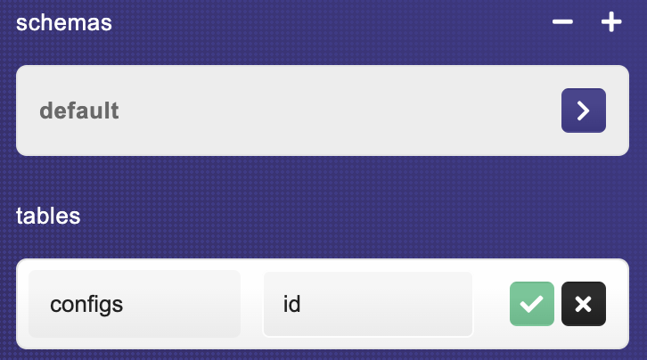

Agora, vamos adicionar um dado simples nessa tabela clicando no botão `+` no canto superior direito:

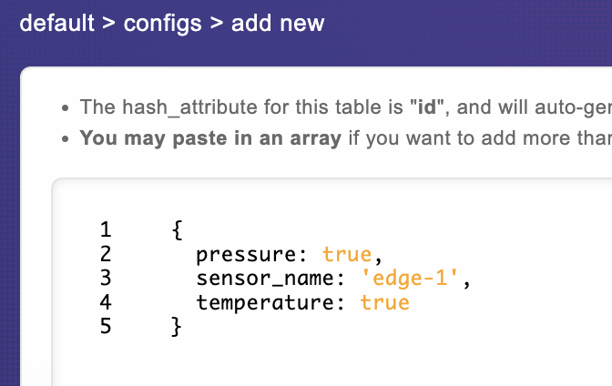

Depois de salvar, vamos trocar para a instância `harper-edge`, e olha só! Agora temos uma tabela configs e dentro dela temos o mesmo item que acabamos de adicionar:

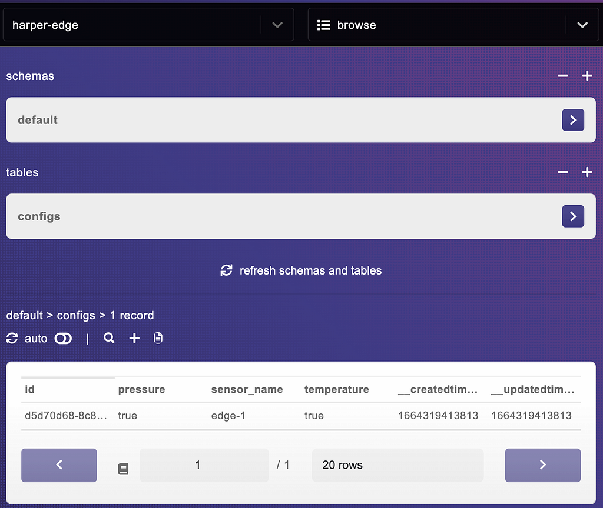

Vamos fazer o mesmo na instância `harper-edge`, e adicionar uma tabela chamada `sensor_data` com um hash de `id`, depois adicionar alguns dados nela:

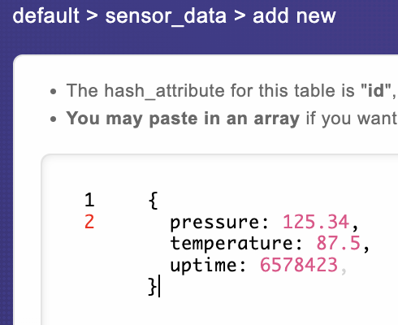

E se voltarmos para o host, vamos ter os mesmos dados lá também:

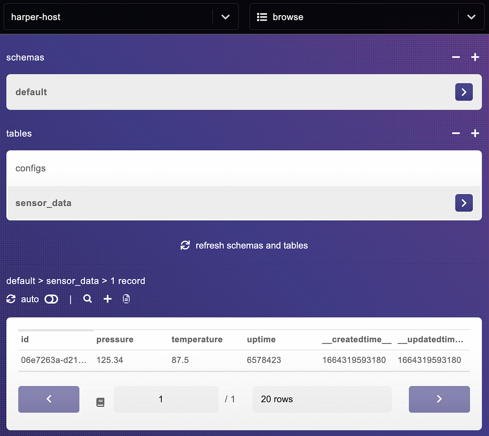

Isso vale até se deletarmos os dados de um dos lados, nesse caso os dados do outro lado também vão ser deletados.

## Conclusão


Essa foi a primeira espiada nessa funcionalidade incrível. Fique ligado nos próximos tutoriais sobre como podemos usar o pub/sub do Harper a nosso favor em outros exemplos do mundo real.
